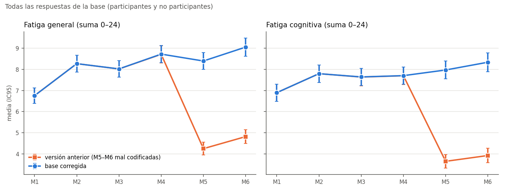
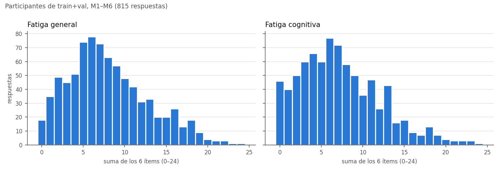
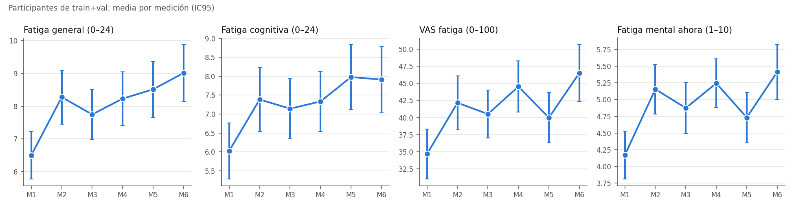

# Paso 1 — Descriptivo de FG y FC (solo cuestionario)

> Línea: fatiga general y cognitiva (PedsQL) frente al EEG. Fecha: 2026-10-22.
> **Solo cuestionario: no se lee EEG ni se entrena ningún modelo.** Solo
> `train` + `val` para los participantes.

## Plan y criterio de decisión (escrito antes de ejecutar)

Esta sección se redactó **antes** de escribir y ejecutar el script y no se ha
modificado después. Los resultados van en las secciones siguientes.

### Por qué este paso, y por qué se rehace

Antes de relacionar FG y FC con el EEG hay que saber qué se mide: si las
puntuaciones son consistentes, cómo se mueven a lo largo del curso, cuánta
varianza es de la persona y cuánta de la sesión, y si la variación de una
sesión a otra es señal o error de medida.

La primera versión de este paso, hecha sobre `BD_COMPLETA_sincalificaciones`,
encontró que FG y FC caían a la mitad entre M4 y M5 en toda la cohorte, solo
en la PedsQL y sin recuperarse. Se planteó como un posible cambio de
administración y se trasladó la pregunta al equipo del estudio. La causa era un
**error de codificación**: los 18 ítems PedsQL de M5 y M6 se habían grabado
como `max(respuesta − 1, 0)`. El equipo lo corrigió en
`BD_COMPLETA_corregida.xlsx` (hoja `AUDIT_CORRECCION_PEDS`), y este paso se
rehace desde cero sobre esa base.

Con el salto corregido, se retiran tres piezas del plan anterior que solo
existían por él (decisión del autor, 2026-10-22):

- la tipificación de cada medición frente a los alumnos sin EEG;
- su ponderación por raking;
- el análisis de sensibilidad con solo M1–M4.

Se sustituyen por un **centrado por medición**, que es lo que corresponde a un
efecto común de calendario como el del VAS.

### Datos

- **Base:** `BD_COMPLETA_corregida.xlsx`, hoja `CUESTIONARIOS` (SHA-256 en
  `resultados.json`).
- **Participantes:** respuestas M1–M6 de las personas de `train` + `val`
  (enlace de `datos_fg_fc.py`). Las de test se apartan antes de calcular nada.
- **Sesiones con EEG:** las sesiones etiquetadas de la Fase 12 en `train` +
  `val` con FG y FC.

### Qué se calcula

0. **La corrección de la base.** Emparejando cada fila con
   `BD_COMPLETA_sincalificaciones` por `(CÓDIGO, medida, centro, pulsera)`
   (en memoria; el código no sale), se comprueba que:
   - los ítems PedsQL de M1–M4 son idénticos;
   - en M5–M6 todas las celdas cumplen `anterior = max(corregida − 1, 0)`.

   Se muestra qué hacía el error (media por medición antes y después) y se
   anotan las anomalías de rango que queden en la PedsQL.
1. **Datos y enlace.** Recuentos, correcciones aplicadas y sesiones con FG/FC.
2. **Puntuación y consistencia.** α de Cronbach, media, SD, asimetría y % en
   0 y en 24 por medición.
3. **Efecto de calendario.** Media por medición de FG, FC, VAS y
   `FATIGA_MENTAL` con IC95. Cambio dentro de persona entre mediciones
   consecutivas. Parte de la varianza intra-persona que explica la medición.
4. **ICC(1)** de FG y FC (brutas y centradas por medición), VAS y
   `FATIGA_MENTAL`. Sobre todas las respuestas M1–M6 y sobre las sesiones con
   EEG, con IC por bootstrap de personas.
5. **Fiabilidad intra-persona.**
   - Se divide cada subescala en dos mitades: ítems impares (1, 3, 5) y pares
     (2, 4, 6).
   - A cada mitad se le quitan los efectos fijos de persona y de medición
     (residuo de MCO con las dos).
   - La correlación entre los residuos de las dos mitades, corregida con
     Spearman-Brown, estima qué parte de la variación de una sesión a otra es
     señal y no error de medida.
6. **Relación con el VAS y `FATIGA_MENTAL`.** ρ de Spearman entre personas
   (medias de las puntuaciones centradas por medición) e intra-persona
   (residuos con efectos fijos de persona y medición).
7. **Sexo, curso y centro.** Diferencias en la media por persona de FG y FC
   centradas: anticipa las covariables del paso 2.
8. **Cobertura con EEG.** Sesiones por medición y por persona.

El centrado por medición de este paso es descriptivo y usa todas las
respuestas de train+val. En los pasos 2 y 3 las medias se estimarán dentro de
cada pliegue de entrenamiento.

IC95 por bootstrap de 2000 réplicas remuestreando personas, semilla 42.

### Criterio fijado de antemano

**Puerta del paso 3.** El análisis intra-persona de una medida (FG o FC) solo
se hace si su fiabilidad intra-persona (punto 5, Spearman-Brown) es
**≥ 0.50**. Por debajo, la mayor parte de la variación de una sesión a otra
sería error de medida y no habría nada que el EEG pudiera seguir; se reportaría
como no analizable.

### Por qué no se tipifica ni se transforma

- **Dentro de persona:** `normalizacion_vas` (pasos 2 y 3) mostró que dividir
  por la SD de cada persona, estimada con 4–6 respuestas, apenas cambia la
  etiqueta y no mejora lo que el EEG consigue.
- **La escala:** las métricas previstas (ρ de Spearman y Random Forest) no
  dependen de transformaciones monótonas. El punto 2 dirá si la asimetría o el
  suelo son tan fuertes que pidan otra cosa.

---

## Resultados

### Tabla resumen

| | FG | FC | VAS |
|---|---|---|---|
| α de Cronbach por medición | 0.79–0.84 | 0.83–0.90 | — |
| Asimetría / % en 0 / % en 24 | 0.60 / 2.2 % / 0.1 % | 0.70 / 5.6 % / 0.1 % | — |
| Media M1 → M6 | 6.5 → 9.0 | 6.0 → 7.9 | 34.7 → 46.5 |
| Varianza intra-persona explicada por la medición | 9.0 % | 6.7 % | 6.1 % |
| **ICC(1)**, respuestas M1–M6 | **0.60** [0.51, 0.66] | **0.64** [0.56, 0.71] | 0.40 [0.32, 0.48] |
| ICC(1), sesiones con EEG | 0.65 [0.55, 0.73] | 0.72 [0.63, 0.78] | 0.49 [0.39, 0.57] |
| **Fiabilidad intra-persona** (Spearman-Brown) | **0.67** [0.60, 0.73] | **0.76** [0.70, 0.80] | — |
| ρ con el VAS, entre personas | 0.63 [0.52, 0.72] | 0.45 [0.31, 0.57] | — |
| ρ con el VAS, intra-persona | 0.40 [0.32, 0.47] | 0.14 [0.05, 0.23] | — |

Tablas completas en `tablas/`, salida íntegra en `ejecucion.log` y cifras en
`resultados.json`.

### 0. La corrección de la base



- **Emparejamiento:** 3790 filas emparejadas con
  `BD_COMPLETA_sincalificaciones` por `(CÓDIGO, medida, centro, pulsera)`.
  - 6 filas solo están en la versión anterior y 3 solo en la corregida. Son las
    3 filas que el equipo eliminó (ninguna con EEG) y las M4–M6 del alumno de
    C3/170, a quien se le quitó la pulsera porque no es participante.
- **M1–M4:** las 45 288 celdas PedsQL son **idénticas**.
- **M5–M6:** las 22 302 celdas cumplen **todas** `anterior = max(corregida −
  1, 0)`.
  - En 1908 de ellas se restaura un 4 que había quedado como 3; la auditoría del
    equipo cuenta 1913 sobre su propio emparejamiento.
  - No hay ningún hueco (NaN) que aparezca o desaparezca.
- **Qué hacía el error:** en toda la base, la media de FG pasaba de 8.7 en M4 a
  4.3 en M5; corregida queda en 8.4. FC pasaba de 7.7 a 3.7; corregida, 8.0.
- **Única anomalía de rango que queda:** un `FS/D_6 = 5` en M3, que ya estaba en
  la versión anterior. FS/D no se analiza y FG y FC están todos en 0–4.

### 1. Datos y enlace

- **Enlace:** las dos correcciones encuentran sus filas (C2/105 M4–M5, 2 filas;
  C2/116 M3, 1 fila) y C3_F066 sigue siendo la única persona con dos códigos.
- **Participantes de train+val:** 843 respuestas de 146 personas, 815 con FG y
  FC. Test apartado: 166 respuestas de 28 personas.
- **Sesiones:** de las 550 etiquetadas de train+val, **534 de 146 personas**
  tienen FG y FC. El VAS de la base coincide con el de `labels.csv` en todas,
  también en `C3_F063_M6`.

### 2. Puntuación y consistencia



- **Consistencia:** α entre 0.79 y 0.84 para FG y entre 0.83 y 0.90 para FC en
  cada medición. M5 y M6 ya no se distinguen de las demás.
- **Escala:** la asimetría es moderada (0.60 y 0.70), apenas hay suelo (2.2 % y
  5.6 % de respuestas en 0) y prácticamente no hay techo (0.1 % en 24).
- **Conclusión:** nada pide transformar la escala; se usa la suma tal cual.

### 3. Efecto de calendario



| Cambio dentro de persona | M2−M1 | M3−M2 | M4−M3 | M5−M4 | M6−M5 |
|---|---|---|---|---|---|
| FG | +2.0 | −0.6 | +0.5 | +0.1 | +0.8 |
| FC | +1.4 | −0.3 | +0.3 | +0.6 | +0.0 |
| VAS | +8.6 | −0.4 | +3.4 | −5.3 | +7.1 |
| `FATIGA_MENTAL` | +1.1 | −0.2 | +0.3 | −0.6 | +0.7 |

- **FG y FC son más bajas en M1** (inicio de curso) y suben despacio el resto
  del año.
- **No tienen el diente de sierra del VAS y de la fatiga mental.** Estas dos
  sí bajan al empezar cada trimestre y suben al terminarlo.
- **La medición explica una parte pequeña pero no despreciable** de la
  variación intra-persona: el 9.0 % en FG y el 6.7 % en FC, frente al 6.1 % del
  VAS. Es la parte que el centrado por medición quita antes de relacionarlas
  con el EEG.

### 4. ICC(1)

| Conjunto | FG | FC | FG centrada | FC centrada | VAS | `FATIGA_MENTAL` |
|---|---|---|---|---|---|---|
| Respuestas M1–M6 (815; VAS 765) | 0.60 [0.51, 0.66] | 0.64 [0.56, 0.71] | 0.62 | 0.66 | 0.40 [0.32, 0.48] | 0.31 [0.24, 0.38] |
| Sesiones con EEG (534) | 0.65 [0.55, 0.73] | 0.72 [0.63, 0.78] | 0.66 | 0.72 | 0.49 [0.39, 0.57] | 0.40 [0.29, 0.49] |

**Entre el 60 % y el 72 % de la varianza de FG y FC es de la persona**, frente
al 40–49 % del VAS. Son sobre todo rasgo: la pregunta entre personas (paso 2)
es donde tienen más varianza y más fiable; dentro de persona queda un tercio o
algo más. Centrar por medición apenas cambia el ICC.

### 5. Fiabilidad intra-persona (puerta del paso 3)

| | r entre mitades | **Spearman-Brown** [IC95] |
|---|---|---|
| FG (815 respuestas, 146 personas) | 0.50 | **0.67** [0.60, 0.73] |
| FC | 0.61 | **0.76** [0.70, 0.80] |

Dos tercios (FG) y tres cuartos (FC) de la variación de una sesión a otra,
descontado el efecto de cada medición, es señal y no error de medida.
**Aplicando el criterio, hay paso 3 para FG y para FC** (las dos ≥ 0.50, con el
IC entero por encima).

### 6. Relación con el VAS y `FATIGA_MENTAL`

| ρ de Spearman [IC95] | Entre personas | Intra-persona |
|---|---|---|
| FG ~ VAS | 0.63 [0.52, 0.72] | **0.40** [0.32, 0.47] |
| FC ~ VAS | 0.45 [0.31, 0.57] | **0.14** [0.05, 0.23] |
| FG ~ `FATIGA_MENTAL` | 0.69 [0.58, 0.77] | 0.47 [0.40, 0.54] |
| FC ~ `FATIGA_MENTAL` | 0.41 [0.28, 0.54] | 0.11 [0.03, 0.20] |
| FG ~ FC | 0.71 [0.61, 0.79] | 0.29 [0.20, 0.38] |
| VAS ~ `FATIGA_MENTAL` | 0.82 [0.74, 0.88] | 0.62 [0.56, 0.68] |

765 respuestas de 146 personas con las cuatro medidas.

- **FG se parece bastante a la fatiga del momento**, también de sesión a sesión
  (ρ = 0.40 con el VAS).
- **FC es otra cosa.** Sus cambios son fiables (0.76), pero apenas acompañan
  al VAS ni a la fatiga mental (0.14 y 0.11). Mide las dificultades cognitivas
  que el alumno percibe, no lo cansado que está ese día.
- **Para el paso 3:** el EEG no siguió al VAS dentro de persona (Fases 14/14b y
  test), así que la expectativa previa para FG intra-persona es baja. FC es la
  medida que más información aporta independiente del VAS.

### 7. Sexo, curso y centro

Media por persona de FG y FC centradas por medición, 146 personas con EEG, en
puntos de la escala 0–24:

| | Diferencia | p (Mann-Whitney / Kruskal-Wallis) | Tamaño del efecto |
|---|---|---|---|
| FG, chicas − chicos | +1.4 | 0.041 | r biserial de rangos = 0.20 |
| FC, chicas − chicos | +1.3 | 0.063 | 0.18 |
| FG, 4.º − 3.º | +2.1 | 0.001 | 0.31 |
| FC, 4.º − 3.º | +1.3 | 0.022 | 0.22 |
| FG, entre los 8 centros | rango 1.6 | 0.85 | η²_H ≈ 0 |
| FC, entre los 8 centros | rango 0.9 | 0.995 | η²_H ≈ 0 |

- **Sexo y curso:** las chicas y 4.º de ESO puntúan más. Como el sexo también
  cambia el EEG (el alfa, por ejemplo), el paso 2 tiene que ajustar por sexo y
  curso.
- **Centro:** no hay diferencias. Se mantiene como covariable, tal como estaba
  planificado: no mueve FG ni FC, pero puede mover el EEG.

### 8. Cobertura con EEG

| | Valor |
|---|---|
| Sesiones por medición, M2…M6 | 41 · 124 · 127 · 119 · 123 |
| Sesiones por persona, 1 / 2 / 3 / 4 / 5 | 10 / 8 / 23 / 86 / 19 personas |
| Personas con ≥ 2 sesiones (universo del paso 3) | 136 personas, 524 sesiones |
| Respuestas M1–M6 por persona con EEG (rasgo del paso 2), 6 / 5 / 4 / 3 | 100 / 35 / 7 / 4 personas |

## Conclusión

1. **La base corregida está bien.** El error de codificación de M5–M6 está
   corregido en todas las celdas y no queda ningún salto. El primer
   descriptivo de esta línea lo detectó: el control de calidad encontró un
   fallo en los datos de origen que nadie había visto.
2. **FG y FC son medidas consistentes** (α ≈ 0.8–0.9) y con una escala
   utilizable tal cual: asimetría moderada y casi sin suelo ni techo.
3. **Tienen un efecto de calendario pequeño:** M1 más baja y una subida suave a
   lo largo del curso, sin el diente de sierra del VAS. Se quita centrando por
   medición.
4. **Son sobre todo rasgo:** el ICC es 0.60–0.72, frente a 0.40–0.49 del VAS.
5. **Su variación intra-persona es fiable** (0.67 y 0.76): hay paso 3 para las
   dos. FG acompaña algo a la fatiga del momento; FC casi no.

## Decisiones para los pasos siguientes

- **Paso 2 (entre personas):** 146 personas.
  - y = media por persona de FG/FC centradas por medición (M1–M6). Las medias
    de cada medición se estiman en el pliegue de entrenamiento.
  - Se ajusta por sexo, curso y centro.
- **Paso 3 (intra persona):** FG y FC, 136 personas con ≥ 2 sesiones (524
  sesiones).

## Lo que **no** hay que hacer

- **Usar `BD_COMPLETA_ConCalificaciones` o `BD_COMPLETA_sincalificaciones`**
  para FG o FC: sus M5 y M6 están mal codificadas.
- **Comparar con las normas publicadas de la PedsQL.** Aquí la escala es de
  acuerdo (0 = totalmente en desacuerdo … 4 = totalmente de acuerdo), no de
  frecuencia, y no se ha transformado a la escala 0–100 inversa del manual.
- **Leer las diferencias de sexo y curso como un hallazgo.** Son descriptivas y
  solo justifican las covariables del paso 2.

## Reproducir

```bash
python analisis/fatiga_fg_fc/01_descriptivo/descriptivo_fg_fc.py > analisis/fatiga_fg_fc/01_descriptivo/ejecucion.log
```

~4 min. Semilla 42 (bootstrap de 2000 réplicas por persona). Lee la base
corregida y, solo para el punto 0, `BD_COMPLETA_sincalificaciones.xlsx`. Los
SHA-256 de las dos están en el log y en `resultados.json`.

## Archivos

| Archivo | Contenido |
|---|---|
| `descriptivo_fg_fc.py` | Script reproducible; usa `../datos_fg_fc.py` y el ICC de `normalizacion_vas` paso 1 |
| `ejecucion.log` | Salida completa |
| `resultados.json` | Todas las cifras, los SHA-256 y la decisión del paso 3 |
| `tablas/correccion_regla.csv` | Verificación celda a celda de la corrección, por medición |
| `tablas/correccion_medias.csv` | Media de FG y FC por medición, antes y después de corregir |
| `tablas/consistencia_por_medicion.csv` | α, media, SD, asimetría, % en 0 y en 24 |
| `tablas/media_por_medicion.csv` | Media e IC de FG, FC, VAS y fatiga mental |
| `tablas/cambio_entre_mediciones.csv` | Cambio dentro de persona entre mediciones consecutivas |
| `tablas/r2_medicion.csv` | Parte de la varianza intra-persona que explica la medición |
| `tablas/icc.csv` | ICC(1) con IC bootstrap |
| `tablas/relacion_vas_fatiga_mental.csv` | ρ entre personas e intra-persona |
| `tablas/sexo_curso_centro.csv` | Diferencias por sexo, curso y centro |
| `figuras/correccion_base.png` | FG y FC por medición, antes y después de la corrección |
| `figuras/calendario.png` | FG, FC, VAS y fatiga mental por medición |
| `figuras/distribucion.png` | Histogramas de FG y FC |
