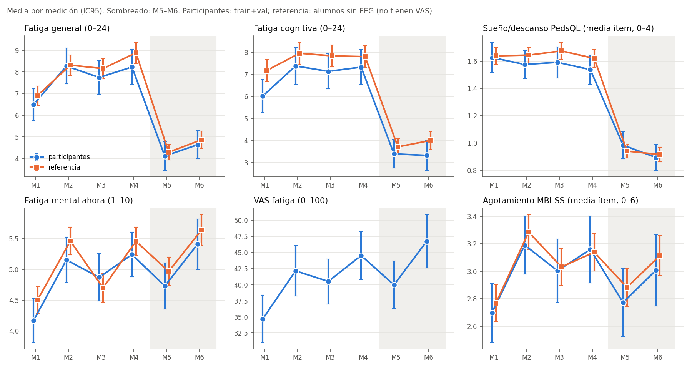
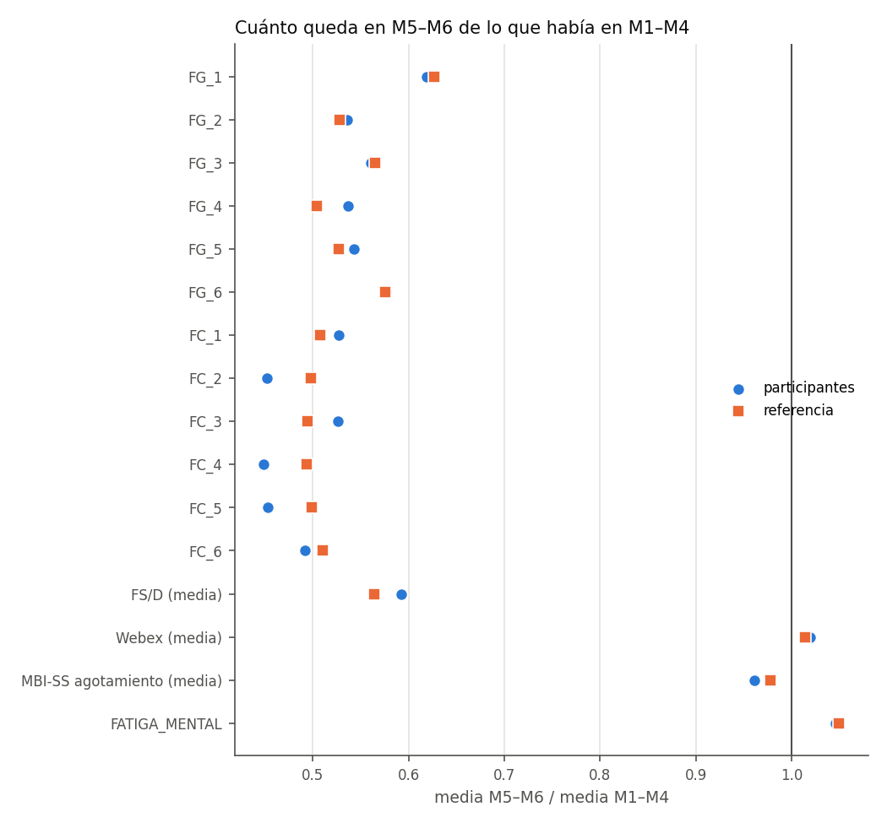
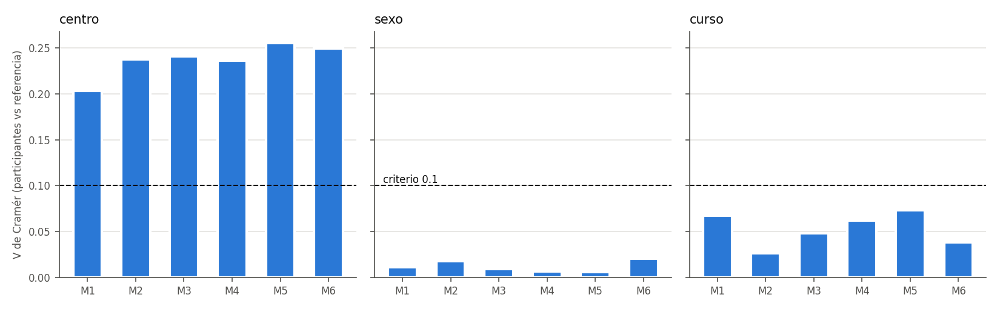
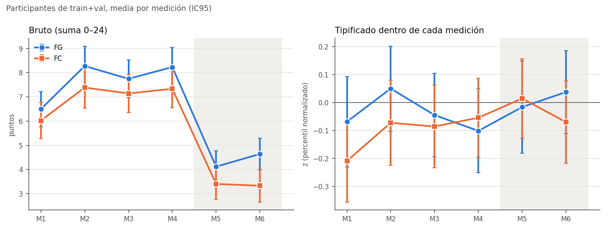

# Paso 1 — Descriptivo de FG y FC (solo cuestionario)

> Línea: fatiga general y cognitiva (PedsQL) frente al EEG. Fecha: 2026-10-22.
> **Solo cuestionario: no se lee EEG ni se entrena ningún modelo.** Solo
> `train` + `val` para los participantes.

## Plan y criterios de decisión (escrito antes de ejecutar)

Esta sección se redactó **antes** de escribir y ejecutar el script y no se ha
modificado después. Los resultados van en las secciones siguientes.

### Por qué este paso

Antes de relacionar FG y FC con el EEG hay que saber qué se mide y en qué
escala se compara. La exploración previa encontró que FG y FC caen a la mitad
entre M4 y M5 en toda la cohorte. Si se mezclan mediciones en bruto, cualquier
deriva del EEG a lo largo del curso (gel, impedancia, habituación al protocolo)
aparecería como relación con FG o FC. Es el confusor de calendario que ya
asomó en `normalizacion_vas` paso 3. Por eso las puntuaciones se tipifican
dentro de cada medición, y este paso fija cómo.

### Datos

- **Participantes:** respuestas M1–M6 de las personas de `train` + `val`
  (enlace de `datos_fg_fc.py`). Las de test se apartan antes de calcular nada.
- **Sesiones con EEG:** las sesiones etiquetadas de la Fase 12 en `train` +
  `val` con FG y FC (533 sesiones de 145 personas; `C3_F063_M6` excluida, ver
  el README de la línea).
- **Referencia:** respuestas de los alumnos sin EEG (no participantes, sin
  pulsera y con un código que nunca aparece con pulsera). No pertenecen a
  ningún split.

### Qué se calcula

1. **Puntuación y consistencia.** Distribución de FG y FC (0–24), % en 0 y α de
   Cronbach por medición, en participantes y referencia.
2. **El salto M4→M5.** Media por medición de FG, FC, `FATIGA_MENTAL`, VAS (solo
   participantes) y de otros bloques del mismo formulario (FS/D, Webex, MBI-SS
   agotamiento). Diferencia M5 − M4 dentro de persona, por centro y por ítem.
   Correlación de FG/FC con el VAS (participantes) y con `FATIGA_MENTAL`
   (referencia) dentro de cada medición, para ver si cambia el constructo o solo
   la escala. **Es descriptivo: no se deriva ninguna decisión de él.** La
   tipificación por medición es obligatoria sea cual sea la causa.
3. **Representatividad de la referencia.** En cada medición, V de Cramér entre
   participantes con EEG (sus respuestas en esa medición) y referencia para
   centro, sexo y curso. En los participantes, el sexo y el curso son los de la
   persona (`caracteristicas_persona`); en la referencia, los de la fila (sexo
   0 u «otro» cuentan como desconocido). También se compara la media de FG y FC.
4. **Tipificación.** Percentil normalizado dentro de cada medición frente a la
   referencia (`percentil_normal`, principal) y z lineal (sensibilidad). Se
   comparan entre sí y se muestra la media por medición antes y después.
5. **ICC(1)** de FG y FC (brutos y tipificados), VAS y `FATIGA_MENTAL`, sobre
   todas las respuestas M1–M6 y sobre las 533 sesiones con EEG. IC por
   bootstrap de personas.
6. **Fiabilidad intra-persona.** Mitades de ítems impares (1, 3, 5) y pares
   (2, 4, 6) de cada subescala. A cada mitad se le quitan los efectos fijos de
   persona y de medición (residuo de MCO con las dos). La correlación entre
   los residuos de las dos mitades, corregida con Spearman-Brown, estima qué
   parte de la variación de una sesión a otra dentro de la persona es señal y
   no error de medida. Como contraste se da la fórmula (α − ICC) / (1 − ICC).
   Sobre todas las respuestas M1–M6 de los participantes, y también solo M1–M4.
7. **Relación con VAS y `FATIGA_MENTAL`.** ρ de Spearman entre personas (medias)
   e intra-persona (residuos con efectos fijos de persona y medición), con FG y
   FC tipificadas.
8. **Sexo, centro y curso.** Diferencias en la media por persona de FG y FC
   tipificadas: anticipa las covariables del paso 2.
9. **Cobertura.** Sesiones con EEG por medición y por persona, en total y solo
   en M2–M4 (análisis de sensibilidad sin M5–M6).

IC95 por bootstrap de 2000 réplicas remuestreando personas, semilla 42.

### Criterios fijados de antemano

**C1. Ponderación de la referencia.** Si alguna V de Cramér (centro, sexo o
curso, en cualquier medición) es **≥ 0.10**, la tipificación principal usa la
referencia **ponderada por raking** (marginales de centro, sexo y curso de los
participantes con EEG de esa medición), en todas las mediciones. La versión sin
ponderar queda como sensibilidad. Si el raking deja un tamaño efectivo de Kish
**< 100** en alguna medición, se pondera solo por centro. Si todas las V son
< 0.10, la principal es sin ponderar.

**C2. Puerta del paso 3.** El análisis intra-persona de una medida (FG o FC)
solo se hace si su fiabilidad intra-persona (punto 6, M1–M6, Spearman-Brown) es
**≥ 0.50**. Por debajo, la mayor parte de la variación de una sesión a otra
sería error de medida y no habría nada que el EEG pudiera seguir. Se reportaría
como no analizable.

### Limitaciones asumidas

- La referencia no tiene VAS (no lo respondieron). Para comparar en los pasos
  2 y 3 con la misma tipificación, el VAS se tipificará por percentil dentro de
  cada medición frente a los participantes del pliegue de entrenamiento, no
  frente a esta referencia.
- La tipificación por medición elimina también cualquier cambio real y común a
  todos a lo largo del curso. No se puede separar del cambio de administración.
- Los pesos del raking dependen de la composición (centro, sexo, curso) de los
  participantes, no de sus puntuaciones. En los pasos 2 y 3 se recalcularán con
  las personas del pliegue de entrenamiento.

---

## Resultados

### Datos

- **Participantes de train+val:** 843 respuestas de 146 personas, 815 con FG y
  FC. Test apartado: 166 respuestas de 28 personas. Quedan fuera 8 personas
  con pulsera sin EEG etiquetado.
- **Enlace:** se aplican las dos correcciones (C2/105 M4–M5, 2 filas; C2/116
  M3, 1 fila) y la excepción de C3_F066, todas con el número de filas esperado.
- **Sesiones con EEG:** de las 550 sesiones etiquetadas de train+val, se
  excluye `C3_F063_M6` y 17 no tienen FG/FC. Quedan **533 sesiones de 145
  personas**.
- **Referencia:** 2750 respuestas de alumnos sin EEG (437–486 por medición).

### Tabla resumen

| | Valor |
|---|---|
| α de Cronbach por medición, FG / FC | 0.78–0.83 / 0.83–0.89 (igual en participantes y referencia) |
| Dentro de persona, M5 − M4: FG / FC | **−4.3 / −4.0 puntos** (baja el 89 % / 85 %) |
| Ídem, VAS / `FATIGA_MENTAL` | −5.3 mm / −0.6 puntos (baja el 53 % / 51 %) |
| Lo que queda en M5–M6 respecto a M1–M4, ítems FG/FC | 45–63 % (referencia 49–63 %) |
| Ídem, otros bloques del formulario (Webex, MBI-SS, `FATIGA_MENTAL`) | 96–105 % |
| V de Cramér participantes–referencia: centro / sexo / curso | 0.20–0.26 / ≤ 0.02 / ≤ 0.07 |
| Tipificación con frente a sin pesos | r = 0.9995, \|dif\| media 0.025 |
| M5 − M4 dentro de persona tras tipificar, FG / FC | +0.06 [−0.07, +0.18] / +0.06 [−0.05, +0.16] |
| **ICC(1) tipificado, FG / FC** (M1–M6) | **0.61 [0.53, 0.67] / 0.65 [0.58, 0.72]** |
| ICC(1) VAS / `FATIGA_MENTAL` (M1–M6) | 0.41 [0.33, 0.48] / 0.31 [0.24, 0.38] |
| **Fiabilidad intra-persona, FG / FC** | **0.66 [0.59, 0.72] / 0.75 [0.69, 0.80]** |
| ρ intra-persona con el VAS, FG / FC | 0.41 [0.33, 0.48] / 0.16 [0.07, 0.25] |
| Sesiones con EEG / personas con ≥ 2 | 533 / 136 (524 sesiones) |

Tablas completas en `tablas/`, salida íntegra en `ejecucion.log` y cifras en
`resultados.json`.

### 1. Puntuación y consistencia

FG y FC son internamente consistentes en todas las mediciones: α entre 0.78 y
0.83 para FG y entre 0.83 y 0.89 para FC, prácticamente iguales en los
participantes y en la referencia. Lo que cambia en M5–M6 es el nivel y el
suelo. En M1–M4, entre el 1.5 % y el 3.6 % de los participantes puntúa 0 en
FG; en M5–M6, entre el 11 % y el 17 %. En FC se pasa del 4–7 % al 28–32 %.

### 2. El salto M4 → M5



| Participantes | M1 | M2 | M3 | M4 | M5 | M6 |
|---|---|---|---|---|---|---|
| FG (0–24) | 6.5 | 8.3 | 7.7 | 8.2 | **4.1** | **4.6** |
| FC (0–24) | 6.0 | 7.4 | 7.1 | 7.3 | **3.4** | **3.3** |
| FS/D (media ítem) | 1.63 | 1.58 | 1.59 | 1.54 | **0.98** | **0.89** |
| `FATIGA_MENTAL` (1–10) | 4.2 | 5.2 | 4.9 | 5.2 | 4.7 | 5.4 |
| VAS (0–100) | 34.7 | 42.2 | 40.5 | 44.5 | 40.0 | 46.7 |

**Cambio dentro de persona entre mediciones consecutivas** (participantes):

| | M2−M1 | M3−M2 | M4−M3 | **M5−M4** | M6−M5 |
|---|---|---|---|---|---|
| FG | +2.0 | −0.6 | +0.5 | **−4.3** [−4.9, −3.7] | +0.8 |
| FC | +1.4 | −0.3 | +0.3 | **−4.0** [−4.5, −3.5] | −0.0 |
| `FATIGA_MENTAL` | +1.1 | −0.2 | +0.3 | −0.6 [−1.0, −0.2] | +0.7 |
| VAS | +8.6 | −0.4 | +3.4 | −5.3 [−9.2, −1.4] | +7.1 |



- **Ocurre en todas partes por igual.** Baja en los 8 centros, en
  participantes y en referencia (16 de 16 combinaciones), y en los 12 ítems de
  FG y FC, que conservan entre el 45 % y el 63 % de su nivel. También cae la
  tercera subescala de la PedsQL (sueño/descanso, 56–59 %).
- **No ocurre fuera de la PedsQL.** El cuestionario Webex de atención, el
  agotamiento del MBI-SS y el ítem de fatiga mental «ahora», que van en el
  mismo formulario, conservan el 96–105 %.
- **No vuelve.** El VAS y `FATIGA_MENTAL` bajan algo en M5 (inicio de
  trimestre, el diente de sierra de `normalizacion_vas` paso 1) y se recuperan
  en M6 (+7.1 mm, +0.7). FG solo recupera +0.8 y FC nada.
- **El orden de los alumnos se mantiene.** Dentro de cada medición, la
  correlación entre personas de FG con el VAS (0.47–0.68) y de FG con la fatiga
  mental en la referencia (0.54–0.65) no empeora en M5–M6
  (`tablas/constructo_por_medicion.csv`). Tampoco la α.

**Lectura.** Las tres subescalas de la PedsQL, y solo ellas, pierden la mitad
de su nivel a la vez en toda la cohorte y no lo recuperan. Mientras tanto, las
medidas de fatiga del mismo día no se mueven más que en el resto del curso.
Lo más compatible con eso es un cambio en cómo se administró o se codificó el
bloque PedsQL a partir de M5 (consigna, anclas o periodo de referencia), no un
cambio real de fatiga. No se puede confirmar sin el equipo del estudio. Como
el orden entre alumnos dentro de cada medición está intacto, tipificar dentro
de la medición conserva la información útil.

### 3. Representatividad de la referencia (criterio C1)



- **Centro: difiere** (V = 0.20–0.26 en todas las mediciones). Es por diseño:
  hay unos 20 participantes por centro, mientras que la referencia sigue el
  tamaño de cada instituto (C5 es el 20 % de la referencia y el 11 % de los
  participantes; C7, el 4 % y el 13 %).
- **Sexo y curso: no difieren** (V ≤ 0.02 y ≤ 0.07).
- **FG y FC:** los participantes puntúan algo menos que la referencia, sobre
  todo en FC (d entre −0.24 y −0.07; en FG, entre −0.14 y +0.02). La
  ponderación apenas mueve esas diferencias.

**Aplicando C1 (V máxima 0.255 ≥ 0.10), la referencia se pondera por raking**
sobre centro, sexo y curso. El tamaño efectivo de Kish queda entre 303 y 342
por medición (≥ 100), con pesos de 0.34 a 4.37. Las 11 filas con sexo 0 u
«otro» quedan con peso 0.

### 4. Tipificación



- **La ponderación es prácticamente irrelevante.** Las puntuaciones con y sin
  pesos correlacionan r = 0.9995 (diferencia media 0.025, máxima 0.13).
- **Percentil frente a z lineal:** r = 0.97–0.98, con una diferencia media de
  0.15–0.16. Es mayor donde está el suelo de M5–M6: justo el caso por el que
  se eligió el percentil como versión principal.
- **El salto desaparece.** Las medias por medición quedan entre −0.21 y +0.05,
  y la diferencia M5 − M4 dentro de persona pasa de −4.3 puntos a +0.06
  [−0.07, +0.18] en FG y +0.06 [−0.05, +0.16] en FC.
- Queda un desplazamiento que no es del salto: en M1 los participantes puntúan
  en FC por debajo de la referencia (−0.21). M1 no tiene EEG, así que solo
  afecta a la media de rasgo del paso 2.

### 5. ICC(1)

| Conjunto | FG bruto | FC bruto | **FG tipificado** | **FC tipificado** | VAS | `FATIGA_MENTAL` |
|---|---|---|---|---|---|---|
| Respuestas M1–M6 (815; VAS 764) | 0.50 | 0.52 | **0.61** [0.53, 0.67] | **0.65** [0.58, 0.72] | 0.41 [0.33, 0.48] | 0.31 [0.24, 0.38] |
| Sesiones con EEG (533) | 0.50 | 0.54 | **0.64** [0.55, 0.71] | **0.71** [0.63, 0.77] | 0.49 [0.39, 0.57] | 0.40 [0.29, 0.50] |

Una vez tipificadas, **unos dos tercios de la varianza de FG y FC son de la
persona**, frente al 40–49 % del VAS. El ICC en bruto sale más bajo porque el
salto de M5 cuenta como variación dentro de persona. FG y FC se comportan sobre
todo como rasgo: la pregunta entre personas (paso 2) es donde tienen más
varianza y más fiable; dentro de persona queda un tercio.

### 6. Fiabilidad intra-persona (criterio C2)

| | r entre mitades | **Spearman-Brown** | (α − ICC)/(1 − ICC) |
|---|---|---|---|
| FG, M1–M6 (815 respuestas, 146 personas) | 0.49 | **0.66** [0.59, 0.72] | 0.55 |
| FG, M1–M4 (544, 145) | 0.48 | 0.65 [0.55, 0.72] | 0.47 |
| FC, M1–M6 | 0.60 | **0.75** [0.69, 0.80] | 0.64 |
| FC, M1–M4 | 0.59 | 0.74 [0.67, 0.80] | 0.51 |

Dos tercios (FG) y tres cuartos (FC) de la variación de una sesión a otra,
descontado el efecto de cada medición, es señal y no error de medida. Sin
M5–M6 sale lo mismo, así que no es un efecto del salto. La fórmula basada en α
da cifras algo más bajas; es una aproximación que mezcla dos estimadores, y se
da solo como contraste.

**Aplicando C2, hay paso 3 para FG y para FC** (las dos ≥ 0.50, con el IC
entero por encima).

### 7. Relación con el VAS y `FATIGA_MENTAL`

| ρ de Spearman [IC95] | Entre personas | Intra-persona |
|---|---|---|
| FG ~ VAS | 0.63 [0.52, 0.72] | **0.41** [0.33, 0.48] |
| FC ~ VAS | 0.46 [0.33, 0.58] | **0.16** [0.07, 0.25] |
| FG ~ `FATIGA_MENTAL` | 0.68 [0.57, 0.76] | 0.47 [0.39, 0.53] |
| FC ~ `FATIGA_MENTAL` | 0.41 [0.28, 0.54] | 0.11 [0.04, 0.19] |
| FG ~ FC | 0.71 [0.61, 0.79] | 0.32 [0.24, 0.40] |
| VAS ~ `FATIGA_MENTAL` | 0.82 [0.73, 0.88] | 0.62 [0.56, 0.68] |

764 respuestas de 146 personas con las cuatro medidas.

- **FG se parece bastante a la fatiga del momento**, también de sesión a sesión
  (ρ = 0.41 con el VAS).
- **FC es otra cosa.** Sus cambios son fiables (0.75), pero casi no acompañan
  al VAS ni a la fatiga mental (0.16 y 0.11). Mide las dificultades cognitivas
  que el alumno percibe, no lo cansado que está ese día.
- Para el paso 3: como el EEG no siguió al VAS dentro de persona (Fases 14/14b
  y test), la expectativa previa para FG intra-persona es baja. FC es la medida
  que más información aporta independiente del VAS.

### 8. Sexo, centro y curso

Medias por persona de FG y FC tipificadas, 145 personas con EEG:

| | Diferencia de medias | p (Mann-Whitney / Kruskal-Wallis) | Tamaño del efecto |
|---|---|---|---|
| FG, chicas − chicos | +0.29 | 0.025 | r biserial de rangos = 0.22 |
| FC, chicas − chicos | +0.26 | 0.039 | 0.20 |
| FG, 4.º − 3.º | +0.40 | 0.001 | 0.32 |
| FC, 4.º − 3.º | +0.25 | 0.021 | 0.22 |
| FG, entre los 8 centros | rango 0.36 | 0.81 | η²_H ≈ 0 |
| FC, entre los 8 centros | rango 0.19 | 0.998 | η²_H ≈ 0 |

Las chicas y 4.º de ESO puntúan más. Entre centros no hay diferencias. El sexo
también cambia el EEG (el alfa, por ejemplo), así que confirma que el paso 2
tiene que ajustar por sexo y curso. El centro se mantiene como covariable, tal
como estaba planificado: no mueve FG ni FC, pero puede mover el EEG.

### 9. Cobertura con EEG

| | Valor |
|---|---|
| Sesiones por medición, M2…M6 | 41 · 124 · 127 · 119 · 122 |
| Sesiones por persona, 1 / 2 / 3 / 4 / 5 | 9 / 8 / 23 / 86 / 19 personas |
| Personas con ≥ 2 sesiones (universo del paso 3) | 136 personas, 524 sesiones |
| Solo M2–M4 (sensibilidad sin M5–M6) | 292 sesiones de 140 personas; con ≥ 2: 119 personas, 271 sesiones |
| Respuestas M1–M4 por persona (rasgo sin M5–M6), 4 / 3 / 2 / 1 | 112 / 29 / 3 / 1 personas |

Como el EEG de M2 solo existe en C1, C6 y C8, la sensibilidad intra-persona
sin M5–M6 se reduce casi siempre a comparar M3 con M4.

## Conclusión

1. **FG y FC son medidas consistentes** (α ≈ 0.8–0.9 en cada medición), pero
   **no son comparables en bruto entre M1–M4 y M5–M6.** Pierden la mitad de su
   nivel en M5 en toda la cohorte, solo en la PedsQL y sin recuperarse. Lo más
   probable es un cambio de administración, pendiente de confirmar con el
   equipo.
2. **Tipificarlas dentro de cada medición frente a los alumnos sin EEG elimina
   el salto** sin perder el orden entre alumnos. La referencia difiere de los
   participantes en centro y se pondera (C1), pero la ponderación apenas cambia
   las puntuaciones.
3. **Son sobre todo rasgo:** dos tercios de su varianza es de la persona (ICC
   0.61 y 0.65), bastante más que en el VAS (0.41).
4. **Su variación intra-persona es fiable** (0.66 y 0.75): hay paso 3 para las
   dos (C2). FG acompaña algo a la fatiga del momento; FC casi no.

## Decisiones para los pasos siguientes

- **C1:** se tipifica con la referencia ponderada por raking (centro, sexo,
  curso). En los pasos 2 y 3, la composición objetivo serán las personas del
  pliegue de entrenamiento.
- **C2:** el paso 3 se hace con FG y con FC.
- **Paso 2 (entre personas):** 145 personas.
  - y = media de FG/FC tipificadas en M1–M6; como sensibilidad, solo M1–M4.
  - Se ajusta por sexo, curso y centro.
  - El VAS de referencia se tipifica por percentil dentro de cada medición
    frente a los participantes del pliegue de entrenamiento.
- **Paso 3 (intra persona):** 136 personas con ≥ 2 sesiones (524 sesiones);
  como sensibilidad, M2–M4 (119 personas, 271 sesiones).
- **Pregunta pendiente para el equipo:** qué cambió en el bloque PedsQL a
  partir de M5 y cuál era el periodo de referencia de la consigna.

## Lo que **no** hay que hacer

- Usar FG o FC en bruto mezclando mediciones, o leer la caída de M5 como una
  bajada de la fatiga.
- Comparar con las normas publicadas de la PedsQL. Aquí la escala es de
  acuerdo (no de frecuencia) y M5–M6 están desplazadas.
- Leer las diferencias de sexo y curso como hallazgo: son descriptivas y solo
  justifican las covariables del paso 2.

## Reproducir

```bash
python analisis/fatiga_fg_fc/01_descriptivo/descriptivo_fg_fc.py > analisis/fatiga_fg_fc/01_descriptivo/ejecucion.log
```

~6 min. Semilla 42 (bootstrap de 2000 réplicas por persona). Dos ejecuciones
dan el mismo log.

## Archivos

| Archivo | Contenido |
|---|---|
| `descriptivo_fg_fc.py` | Script reproducible; usa `../datos_fg_fc.py` y el ICC de `normalizacion_vas` paso 1 |
| `ejecucion.log` | Salida completa |
| `resultados.json` | Todas las cifras y las decisiones C1 y C2 |
| `tablas/consistencia_por_medicion.csv` | α, media, SD y % en 0 por medición y grupo |
| `tablas/media_por_medicion.csv` | Media e IC de FG, FC, FS/D, Webex, MBI-SS, fatiga mental y VAS |
| `tablas/cambio_entre_mediciones.csv` | Cambio dentro de persona entre mediciones consecutivas |
| `tablas/m5_menos_m4_por_centro.csv` | Salto M4→M5 por centro y grupo |
| `tablas/razon_por_item.csv` | Media M5–M6 / M1–M4 por ítem y bloque |
| `tablas/constructo_por_medicion.csv` | Correlaciones entre personas dentro de cada medición |
| `tablas/representatividad_v_cramer.csv` | V de Cramér por medición y variable |
| `tablas/representatividad_diferencias.csv` | d participantes − referencia, con y sin pesos |
| `tablas/tipificada_por_medicion.csv` | Media bruta y tipificada por medición |
| `tablas/icc.csv` | ICC(1) con IC bootstrap |
| `tablas/relacion_vas_fatiga_mental.csv` | ρ entre personas e intra-persona |
| `tablas/sexo_centro_curso.csv` | Diferencias por sexo, curso y centro |
| `figuras/salto_por_medicion.png` | Media por medición de FG, FC, FS/D, fatiga mental, VAS y MBI-SS |
| `figuras/razon_por_item.png` | Cuánto conserva cada ítem y bloque en M5–M6 |
| `figuras/representatividad.png` | V de Cramér con el criterio C1 |
| `figuras/tipificacion.png` | Medias por medición antes y después de tipificar |
