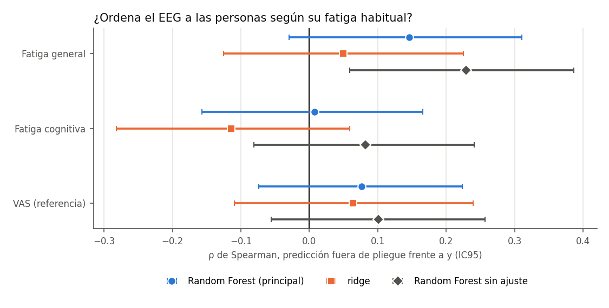
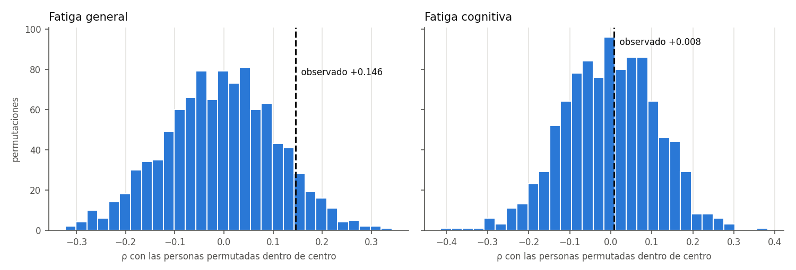
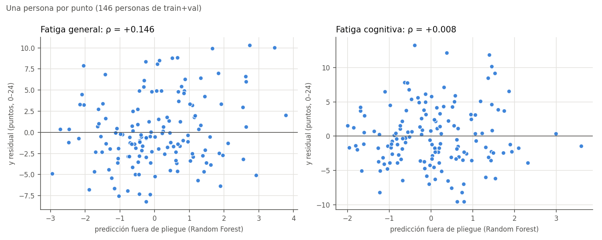

# Paso 2 — Entre personas: ¿tienen otro EEG quienes suelen estar más fatigados?

> Línea: fatiga general y cognitiva (PedsQL) frente al EEG. Fecha: 2026-10-22.
> **Solo `train` + `val`.** El test está gastado: todo lo de este paso es
> **exploratorio** y así debe citarse.

## Plan y reglas de lectura (escrito antes de ejecutar)

Esta sección se redactó **antes** de escribir y ejecutar el script y no se ha
modificado después.

### Pregunta

¿Los alumnos con más fatiga general (FG) o cognitiva (FC) **habitual** tienen
un perfil EEG habitual distinto, una vez descontado lo que explican su sexo, su
curso y su centro?

FG y FC son sobre todo rasgo: entre el 60 % y el 72 % de su varianza es de la
persona (paso 1, ICC). Por eso este paso compara personas entre sí: una fila
por persona, con su nivel habitual de fatiga y su EEG medio. El paso 3 se
ocupará de los cambios de una sesión a otra dentro de cada persona.

### Datos

- **Personas:** las 146 de `train` + `val` con al menos una sesión EEG
  etiquetada con FG y FC (534 sesiones; paso 1). El test se aparta al leer la
  matriz, antes de agregar nada.
- **y (una por persona y medida):** la media de sus respuestas FG (o FC) de
  M1–M6, centradas por medición.
  - Se usan todas las respuestas, no solo las de sesiones con EEG: con 5–6
    respuestas por persona el rasgo se estima con más fiabilidad, y el rasgo no
    depende del día del EEG.
  - Las medias de cada medición se estiman con las personas del pliegue de
    entrenamiento.
- **Ajuste por covariables:** dentro de cada pliegue se ajusta en el
  entrenamiento un modelo lineal y ~ sexo + curso + centro y se le quita a y su
  parte predicha, en entrenamiento y en evaluación. Lo que el modelo EEG tiene
  que predecir es ese residuo. El sexo y el curso mueven FG y FC (paso 1) y el
  sexo mueve el EEG, así que sin el ajuste el EEG podría «acertar» la fatiga a
  través del sexo. El centro no mueve FG ni FC, pero puede mover el EEG (sala,
  equipo).
- **X (una por persona):** la media, sobre las sesiones EEG de la persona, de
  la matriz de sesión de la Fase 14 (`agregar_a_sesion`).
  - **70 features espectrales:** `columnas_de_features` sin `condicion_orden`,
    sin los 6 contadores de procesamiento (`n_ventanas`, `n_canales_buenos`,
    `n_validos_*`) y sin `n_grabaciones`. Los contadores fueron un atajo de
    duración demostrado (0.99 en reposo/tarea, Fases 18–19 y test), y
    `n_grabaciones` no es señal cerebral.
  - Cada feature se centra por medición antes de promediar. Las medias de cada
    medición salen de las sesiones de las personas de entrenamiento. Así, que
    una persona tenga o no EEG en M2 (solo en C1, C6 y C8) no cambia su media.
  - Los NaN (regiones sin canales válidos) se dejan al Random Forest, que los
    admite; el modelo lineal imputa la mediana del entrenamiento.

### Modelos y validación

- **Validación:** 5 pliegues estratificados por centro (`StratifiedKFold`,
  barajado con semilla 42). Con una fila por persona, partir por filas es partir
  por persona: el modelo nunca ve a quien evalúa. Estratificar por centro deja
  unas 3–4 personas de cada centro en cada pliegue, para que el ajuste por
  centro se pueda estimar.
- **Principal: Random Forest de regresión**, 500 árboles, hoja ≥ 5, semilla 42.
  Es la configuración de la Fase 14: cambiar de modelo sería otra bifurcación.
- **Secundario: ridge** (imputación por mediana, escalado y `RidgeCV` con α
  elegido entre 10⁻² y 10⁴ dentro del entrenamiento de cada pliegue). Es el
  modelo lineal regularizado que pidió el autor.

### Estadístico principal

**ρ de Spearman entre la predicción fuera de pliegue y el y residual**, por
medida (FG y FC), con el Random Forest.

- **Por qué ρ y no R²:** la pregunta es si hay relación, no si se puede
  predecir un número. ρ fue además la única métrica estable en la Fase 14. El
  R² fuera de pliegue se da como descriptivo.
- **IC95:** bootstrap de 2000 réplicas remuestreando personas sobre las
  predicciones fuera de pliegue.
- **p unilateral (ρ > 0):** 1000 permutaciones. En cada una se reasigna el
  conjunto de respuestas de cada persona a otra persona del mismo centro y se
  repite todo (centrado, ajuste, modelo y validación). X y las covariables no
  se tocan.

### Hipótesis a priori de una sola variable (secundarias)

Correlación parcial de Spearman, ajustada por sexo, curso y centro, entre y y
la media por persona de:

1. **El índice θ/α** (`indice_fatiga_media`: theta frontal / alfa posterior),
   el biomarcador de fatiga de la literatura, que la memoria tiene que reportar.
2. **El compuesto `_rel_sd`** (`compuesto_rel_sd`: media de las z de las 16
   features `_rel_sd`, con la media y la SD de las sesiones de train+val), la
   única pista positiva que tuvo el proyecto con el VAS.

Las dos con la dirección esperada positiva (más índice o más variabilidad, más
fatiga) y p unilateral por 10 000 permutaciones dentro de centro.

### Referencia: el VAS por el mismo camino

El VAS de cada persona (media de M1–M6, centrada por medición) pasa por el
mismo pipeline, con el mismo X, las mismas covariables y los mismos pliegues.
Se da la diferencia **emparejada** ρ(FG) − ρ(VAS) y ρ(FC) − ρ(VAS), con IC por
bootstrap de personas. Responde directamente a si FG o FC se reflejan en el EEG
más que el VAS. Es descriptivo, no entra en ninguna familia.

### Multiplicidad

- **Familia principal (4 pruebas, Holm):** FG y FC, entre personas (este paso)
  e intra-persona (paso 3), con el Random Forest. Aquí se dan las p sin
  corregir; la corrección de Holm, y con ella el veredicto, se da en el paso 3,
  cuando estén las cuatro.
- **Familia secundaria (8 pruebas, Holm):** θ/α y `_rel_sd` × FG y FC × los dos
  niveles. Igual: p sin corregir aquí y Holm en el paso 3.
- **Descriptivo, sin p:** ridge, R², referencia VAS, sensibilidades.

### Sensibilidades (descriptivas)

- Ridge en lugar de Random Forest.
- Sin el ajuste por sexo, curso y centro.
- Estabilidad: semillas 1–4 (cambian a la vez el reparto en pliegues y el
  bosque).

### Reglas de lectura

1. **Hay relación entre personas para una medida** solo si su p corregida por
   Holm (en el paso 3) es < 0.05 **y** el IC95 de ρ excluye el 0.
2. **Si el Random Forest y ridge discrepan** (uno excluye el 0 y el otro no), se
   reportan los dos y se lee como fragilidad, no como hallazgo.
3. **Si el IC contiene el 0**, se dice que no hay evidencia de relación, no que
   no la haya. Con 146 personas, el ρ mínimo que se detectaría con un 80 % de
   probabilidad es ≈ 0.21 sin corregir y ≈ 0.25 con Holm. Un efecto menor de
   ~0.2 no se distingue del cero con estos datos.
4. **La referencia VAS se lee en emparejado:** que FG o FC superen al VAS solo
   cuenta si el IC de la diferencia excluye el 0.

### Expectativa previa, por escrito

Con el VAS por sesión, el EEG no predijo a una persona nueva (Fase 14, Tarea A:
R² = −0.010) y su único orden débil (ρ = +0.12) no se replicó en test (S5:
ρ = −0.010). FG y FC son más estables como rasgo, y su media por persona es más
fiable que un VAS suelto, así que el techo de lo detectable es algo más alto.
Aun así, lo esperable es un efecto pequeño o nulo.

### Lo que este paso evita, de lo ya aprendido

- **Reconocer a la persona en vez de su fatiga** (33× el azar en la Fase 14):
  aquí no puede pasar, porque cada persona es una sola fila.
- **Atajos de duración:** los contadores de procesamiento quedan fuera de X.
- **Calendario:** y y X se centran por medición.
- **Bifurcaciones:** un solo modelo principal, una sola métrica, plan escrito
  antes y todas las variantes reportadas.
- **Test:** no se lee.

---

## Resultados

### Datos y desviaciones del plan

- **146 personas, 531 sesiones EEG, 70 features.** El test (732 grabaciones)
  se aparta antes de agregar. Pliegues de 29–30 personas.
- **Respuestas M1–M6:** 815 de FG y FC y 787 de VAS. Las covariables están
  completas: 75 chicas y 71 chicos, 77 de 4.º y 69 de 3.º, y de 17 a 20
  personas por centro.
- **Desviación 1: 531 sesiones, no 534.** Tres sesiones etiquetadas no tienen
  ventanas EEG válidas (las mismas que descarta la Fase 14). Se detectó al
  preparar este paso y se corrigió en el módulo común y en el paso 1 (ver su
  `INFORME`). No cambia ninguna persona: las tres tienen otras sesiones.
- **Desviación 2, de implementación:** el índice θ/α y el compuesto `_rel_sd`
  se centran por medición antes de promediar por persona, igual que el resto
  de X. Las medias salen de todas las sesiones de train+val, porque aquí no hay
  validación cruzada.
- **Desviación 3, de implementación:** las 1000 permutaciones se reparten
  entre núcleos. Las reasignaciones se generan antes y en orden con la semilla
  42, y el bosque es idéntico con cualquier número de hilos. Se comprobó con 20
  permutaciones que la distribución nula sale exactamente igual que en serie.

### Estadístico principal (Random Forest)

| | ρ fuera de pliegue [IC95] | p unilateral (sin corregir) | Nula: media / P95 | R² |
|---|---|---|---|---|
| **FG** | **+0.146** [−0.029, +0.311] | **0.081** | −0.007 / +0.175 | +0.024 |
| **FC** | **+0.008** [−0.157, +0.166] | **0.468** | −0.002 / +0.175 | −0.042 |





- **FG:** el bosque ordena a las personas algo mejor que el azar (ρ = +0.15),
  pero el IC contiene el 0 y el 8 % de las permutaciones da un ρ igual o mayor.
- **FC:** nada (ρ = +0.01).
- **Con Holm no hay nada que esperar del paso 3 para estas dos pruebas.** Holm
  nunca permite un umbral mayor que 0.05, y las dos p ya lo superan. Por la
  regla 1, **no hay evidencia de relación entre personas ni con FG ni con FC.**



### Variantes y sensibilidades

| ρ [IC95] | FG | FC | VAS (referencia) |
|---|---|---|---|
| **Random Forest (principal)** | **+0.146** [−0.029, +0.311] | **+0.008** [−0.157, +0.166] | +0.076 [−0.074, +0.224] |
| Ridge | +0.050 [−0.126, +0.225] | −0.114 [−0.282, +0.059] | +0.064 [−0.109, +0.239] |
| Random Forest sin ajuste por sexo, curso y centro | +0.229 [+0.059, +0.387] | +0.082 [−0.081, +0.241] | +0.101 [−0.056, +0.256] |

Estabilidad del Random Forest (cambiando a la vez el reparto en pliegues y el
bosque):

| Semilla | 42 | 1 | 2 | 3 | 4 | Media (SD) |
|---|---|---|---|---|---|---|
| FG | +0.146 | +0.128 | +0.099 | +0.172 | +0.142 | +0.137 (0.027) |
| FC | +0.008 | −0.010 | −0.045 | −0.018 | −0.006 | −0.014 (0.020) |

- **Ridge no reproduce el ρ de FG** (+0.05). Ninguno de los dos modelos
  excluye el 0, así que no se aplica la regla 2 (discrepancia), pero el orden
  débil que ve el bosque no es lineal o no es robusto.
- **El ρ de FG es estable frente a la semilla** (0.10–0.17), así que no es una
  partición afortunada. Es un efecto pequeño y constante, del tamaño que con 146
  personas no se distingue del cero (el plan fijaba ≈ 0.21 como mínimo
  detectable).
- **Sin el ajuste, FG sube a +0.23 y su IC excluye el 0.** Parte de lo que el
  EEG «ve» de la fatiga general entre personas es el sexo, el curso o el centro,
  que mueven a la vez FG y el EEG. Es el confusor que el ajuste estaba para
  quitar, y confirma que hacía falta.

### Referencia: el VAS por el mismo camino

| Diferencia emparejada (Random Forest) | [IC95] |
|---|---|
| ρ(FG) − ρ(VAS) | +0.070 [−0.116, +0.241] |
| ρ(FC) − ρ(VAS) | −0.069 [−0.250, +0.114] |

Ninguna de las dos medidas se refleja en el EEG más que el VAS. El VAS medio
por persona tampoco tiene relación con el EEG (+0.08), en línea con la Tarea A
de la Fase 14.

### Hipótesis a priori (secundarias)

| ρ parcial (sexo, curso, centro) [IC95] | p unilateral, ρ > 0 (sin corregir) |
|---|---|
| FG ~ índice θ/α: **−0.170** [−0.343, −0.003] | 0.976 |
| FG ~ compuesto `_rel_sd`: +0.145 [−0.037, +0.314] | 0.044 |
| FC ~ índice θ/α: **−0.148** [−0.306, +0.008] | 0.963 |
| FC ~ compuesto `_rel_sd`: +0.134 [−0.039, +0.297] | 0.057 |

146 personas; 10 000 permutaciones dentro de centro.

- **Ninguna de las cuatro puede salir significativa con Holm.**
  - En la familia de 8 están las dos p de θ/α (0.96 y 0.98), que son más
    grandes. Por eso la menor p de `_rel_sd` ocuparía como mucho el 6.º puesto,
    con un umbral de 0.05/3 = 0.017.
  - 0.044 y 0.057 quedan por encima de ese umbral, haga lo que haga el paso 3.
- **`_rel_sd`:** va en la dirección esperada (más variabilidad espectral, más
  fatiga), con el mismo tamaño que tuvo con el VAS en validación (≈ +0.13–0.16).
  Es un indicio que no alcanza la significación y que, con el VAS, no se replicó
  en test.
- **θ/α va en la dirección contraria a la hipótesis.** Las personas con más
  fatiga habitual tienen un índice θ/α algo *menor*, y en FG el IC queda por
  poco por debajo del 0. El plan fijó una prueba unilateral positiva, así que
  esto no es un resultado. Se reporta como observación discordante y no se
  interpreta: sería elegir la dirección después de ver los datos.

## Conclusión

1. **No hay evidencia de que el EEG habitual de una persona refleje su fatiga
   general o cognitiva habitual.** El ρ principal es +0.15 (p = 0.08) para FG y
   +0.01 para FC. Con Holm, ninguna puede ser significativa.
2. **FG muestra un orden débil y estable** (ρ ≈ 0.14 con cinco semillas), del
   mismo tamaño que el que tuvo el VAS para una persona nueva en la Fase 14
   (ρ = +0.12), que no se replicó en test. Ridge no lo reproduce. Es compatible
   con un efecto pequeño o con nada; estos datos no distinguen entre las dos
   cosas.
3. **Ajustar por sexo, curso y centro era necesario.** Sin el ajuste, FG
   aparenta una relación (+0.23, IC sin el 0) que en parte no es fatiga.
4. **FG y FC no superan al VAS** como diana para el EEG entre personas.
5. **Las hipótesis de la literatura y del proyecto no se sostienen** a este
   nivel: θ/α va en contra de lo esperado y `_rel_sd` repite su indicio débil
   sin llegar a la significación.

## Lo que **no** hay que hacer

- **Citar el +0.15 de FG como relación.** El IC contiene el 0, p = 0.08 sin
  corregir, y con Holm no puede salir.
- **Citar el +0.23 sin ajuste.** Incluye diferencias de sexo, curso y centro.
- **Leer el θ/α negativo como hallazgo**, ni darle la vuelta a la hipótesis.
- **Probar más modelos o features sobre estas 146 personas** buscando que algo
  salga. Es la bifurcación que la línea `normalizacion_vas` ya mostró que vuelve
  frágiles los resultados.

## Reproducir

```bash
python analisis/fatiga_fg_fc/02_entre_personas/entre_personas.py > analisis/fatiga_fg_fc/02_entre_personas/ejecucion.log
python analisis/fatiga_fg_fc/02_entre_personas/entre_personas.py --rapido   # depuración; sus cifras no son resultados
```

~20 min con 12 núcleos (las permutaciones del Random Forest). Semilla 42 en
los pliegues, el bosque, el bootstrap y las permutaciones; semillas 1–4 solo
para la estabilidad. Los SHA-256 de la base y de `matriz_rf.parquet` están en
el log y en `resultados.json`.

## Archivos

| Archivo | Contenido |
|---|---|
| `entre_personas.py` | Script reproducible; usa `../datos_fg_fc.py` |
| `ejecucion.log` | Salida completa |
| `resultados.json` | Todas las cifras, parámetros y SHA-256 |
| `tablas/rho_por_variante.csv` | ρ, IC, R² y p de cada objetivo y variante |
| `tablas/diferencia_con_vas.csv` | Diferencias emparejadas con el VAS |
| `tablas/apriori.csv` | Correlaciones parciales de θ/α y `_rel_sd` |
| `tablas/estabilidad_semillas.csv` | ρ del Random Forest con las semillas 42 y 1–4 |
| `figuras/rho_por_variante.png` | ρ con IC de cada objetivo y variante |
| `figuras/prediccion_frente_a_observado.png` | Predicción fuera de pliegue frente al y residual, una persona por punto |
| `figuras/distribucion_nula.png` | Distribución nula de las permutaciones y valor observado |
