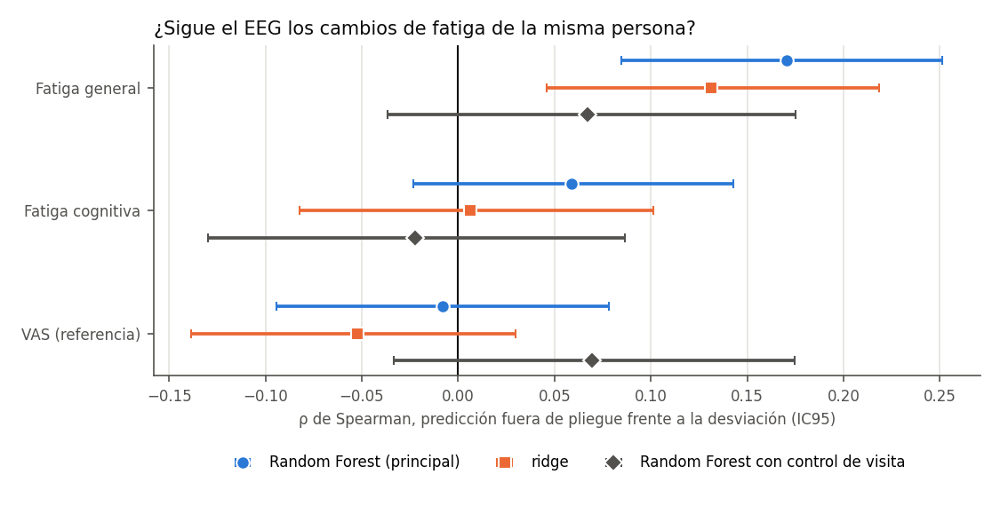
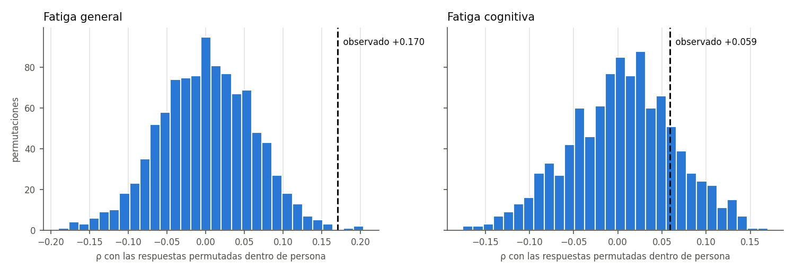

# Paso 3 — Intra persona: ¿cambia el EEG cuando cambia la fatiga de la misma persona?

> Línea: fatiga general y cognitiva (PedsQL) frente al EEG. Fecha: 2026-10-22.
> **Solo `train` + `val`.** El test está gastado: todo lo de este paso es
> **exploratorio** y así debe citarse. Este paso cierra las familias de
> pruebas de la línea con Holm.

## Plan y reglas de lectura (escrito antes de ejecutar)

Esta sección se redactó **antes** de escribir y ejecutar el script y no se ha
modificado después.

### Pregunta

Cuando un alumno está más fatigado de lo habitual **en él** (FG o FC por encima
de su propio nivel), ¿su EEG de esa sesión se aparta también de su EEG
habitual?

Es la Tarea B de la Fase 14 («persona conocida») con FG y FC como diana. El
paso 1 abrió la puerta para las dos medidas: su variación de una sesión a otra
es fiable (0.67 en FG y 0.76 en FC). FC además apenas acompaña al VAS dentro de
persona (ρ = 0.14), así que es información que el proyecto no ha probado
todavía.

### Datos

- **Sesiones:** las 521 sesiones con EEG, FG y FC de las 136 personas de
  `train` + `val` con al menos dos (paso 1). Hacen falta dos para que la
  persona tenga un EEG «habitual» con el que comparar. El test se aparta al leer
  la matriz, antes de agregar.
- **y (una por sesión y medida):** el FG (o FC) de la sesión, con dos pasos:
  1. Se centra por medición, con las medias de las personas del pliegue de
     entrenamiento.
  2. Se le resta la media de las **otras** respuestas de la persona (leave-one-out),
     también centradas por medición.

  Para el nivel habitual se usan todas sus respuestas M1–M6, tengan o no EEG.
  `normalizacion_vas` paso 2 mostró que estimar el nivel con todas las
  respuestas da una referencia mejor que con solo las sesiones con EEG. Con el
  centrado por medición, M1 entra sin necesidad de corregirla aparte.
- **X (una por sesión):** las 70 features espectrales de la sesión (las mismas
  del paso 2), con los mismos dos pasos:
  1. Se centran por medición, con las medias de las sesiones de las personas de
     entrenamiento.
  2. Se les resta la media de las otras sesiones EEG de la persona
     (`centrar_por_persona_loo`, la función de la Fase 14).
- **Por qué se centran X e y a la vez** (Fase 14): las features identifican a
  la persona 33 veces por encima del azar. Si solo se centrase y, el modelo
  podría reconocer a la persona y devolver su nivel habitual. Centrando los dos
  lados, reconocer a la persona deja de servir.
- **Sin covariables.** El sexo, el curso y el centro son constantes dentro de
  la persona, así que el centrado por persona ya los quita.

### Modelos y validación

- **Validación:** `GroupKFold(5)` por `persona_uid`, el banco de la Fase 14. El
  modelo nunca ve a la persona que evalúa, y cada sesión recibe una predicción
  fuera de pliegue.
- **Principal: Random Forest de regresión**, 500 árboles, hoja ≥ 5, semilla
  42, igual que en el paso 2.
- **Secundario: ridge**, también igual que en el paso 2 (imputación por
  mediana, escalado, `RidgeCV` con α entre 10⁻² y 10⁴ dentro del
  entrenamiento).

### Estadístico principal

**ρ de Spearman entre la predicción fuera de pliegue y el y de cada sesión**,
por medida, con el Random Forest.

- **IC95:** bootstrap de 2000 réplicas remuestreando personas (con todas sus
  sesiones).
- **p unilateral (ρ > 0):** 1000 permutaciones **dentro de persona**. En cada
  una se baraja qué respuesta FG (o FC) corresponde a cada sesión EEG de la
  persona y se repite todo (centrado, modelo y validación). Así se rompe la
  correspondencia sesión a sesión y se conserva todo lo demás: el nivel de la
  persona, su EEG y sus respuestas sin EEG.
- El R² fuera de pliegue se da como descriptivo.

### Hipótesis a priori (secundarias)

ρ de Spearman intra-persona entre y y el índice θ/α y el compuesto `_rel_sd`,
centrados igual que X (por medición y por persona, leave-one-out). Se usan la
misma dirección positiva y las mismas variables que en el paso 2 (fijadas allí
antes de ejecutar). La p es unilateral, por 10 000 permutaciones dentro de
persona.

### Referencia: el VAS por el mismo camino

El VAS de cada sesión pasa por el mismo pipeline. Es la Tarea B de la Fase 14
en regresión, con el centrado por medición y el nivel habitual estimado con
todas las respuestas. Se da la diferencia **emparejada** ρ(FG) − ρ(VAS) y
ρ(FC) − ρ(VAS) sobre las mismas sesiones, con IC por bootstrap de personas.
Es descriptivo.

### Multiplicidad: cierre de las familias

- **Familia principal (Holm, 4 pruebas):** FG y FC del paso 2 (p = 0.081 y
  0.468) y FG y FC de este paso.
- **Familia secundaria (Holm, 8 pruebas):** las 4 del paso 2 (0.976, 0.044,
  0.963 y 0.057) y las 4 de este paso.
- Se da la tabla completa con p sin corregir y corregida, y el veredicto de cada
  prueba.

### Sensibilidades (descriptivas)

- Ridge en lugar de Random Forest.
- **Con control de visita:** recta por persona sobre el número de visita, en X
  y en y, después del centrado (`residualizar_por_visita`, como en el
  pre-registro del test). Es un control conservador: si la fatiga cambiase de
  forma monótona durante el curso, también se llevaría señal real.
- Estabilidad: semillas 1–4 del bosque. Los pliegues de `GroupKFold` son fijos,
  como en la Fase 14.

### Reglas de lectura

1. **Hay relación intra-persona para una medida** solo si su p corregida por
   Holm es < 0.05 **y** el IC95 de ρ excluye el 0.
2. **Si el Random Forest y ridge discrepan** (uno excluye el 0 y el otro no), se
   lee como fragilidad, no como hallazgo.
3. **Si el IC contiene el 0**, no hay evidencia de relación, que no es lo mismo
   que no haya relación. Con 521 sesiones de 136 personas, el ρ mínimo
   detectable con un 80 % de probabilidad es ≈ 0.13 sin corregir y ≈ 0.16 con
   Holm (aproximado: las sesiones de una persona no son independientes).
4. **Si FG da relación pero el VAS no**, la diferencia emparejada dice si es
   algo propio de FG. Si su IC contiene el 0, FG no aporta sobre el VAS: dentro
   de persona se parecen (ρ = 0.40, paso 1).
5. **Si la relación desaparece con el control de visita**, se reporta como
   dependiente de la deriva a lo largo del curso, no como fatiga.

### Expectativa previa, por escrito

- **FG:** con el VAS, la Tarea B dio en validación un orden débil (ρ ≈ +0.10 en
  regresión; 0.39 de exactitud balanceada en tres niveles) que el test no
  confirmó. FG dentro de persona se parece al VAS, así que lo esperable es algo
  parecido: pequeño o nulo.
- **FC:** es la incógnita real de la línea. Sus cambios son fiables e
  independientes del VAS, pero no hay ninguna razón previa para esperar un
  efecto grande.

### Lo que este paso evita, de lo ya aprendido

- **Reconocer a la persona:** X e y se centran a la vez, y la validación agrupa
  por persona.
- **Calendario:** X e y se centran por medición, y el control de visita va como
  sensibilidad.
- **Atajos de duración:** los contadores de procesamiento quedan fuera de X.
- **Bifurcaciones:** un solo modelo principal, una sola métrica, plan escrito
  antes, todas las variantes reportadas y Holm sobre las familias completas.
- **Test:** no se lee.

---

## Resultados

### Datos y desviaciones del plan

- **Datos:** 136 personas con ≥ 2 sesiones (quedan fuera 10 que solo tienen una),
  521 sesiones y 793 respuestas M1–M6. El test (732 grabaciones) se aparta antes
  de agregar.
- **Pliegues:** 27–28 personas y 104–105 sesiones cada uno.
- **Sesiones por medición** (M2…M6): 37 · 122 · 126 · 117 · 119.
- **Implementación:** las 1000 permutaciones se reparten entre núcleos, igual
  que en el paso 2 (reasignaciones generadas antes y en orden con la semilla
  42). En las a priori, que no tienen validación cruzada, se permuta la
  desviación final dentro de persona.
- **No hay desviaciones del plan.**

### Estadístico principal (Random Forest)

| | ρ fuera de pliegue [IC95] | p unilateral (sin corregir) | Nula: media / P95 | R² |
|---|---|---|---|---|
| **FG** | **+0.170** [+0.085, +0.251] | **0.004** | +0.001 / +0.099 | +0.013 |
| **FC** | **+0.059** [−0.023, +0.143] | **0.180** | +0.005 / +0.102 | −0.019 |





- **FG:** de 1000 permutaciones, solo 3 igualan o superan el ρ observado. El
  efecto es pequeño: el R² es +0.013, así que no sirve para predecir un número.
- **FC:** no se distingue del azar.

### Variantes y sensibilidades

| ρ [IC95] | FG | FC | VAS (referencia) |
|---|---|---|---|
| **Random Forest (principal)** | **+0.170** [+0.085, +0.251] | **+0.059** [−0.023, +0.143] | −0.008 [−0.095, +0.078] |
| Ridge | +0.131 [+0.046, +0.219] | +0.006 [−0.082, +0.101] | −0.052 [−0.139, +0.030] |
| Random Forest con control de visita | **+0.067** [−0.037, +0.175] | −0.022 [−0.130, +0.087] | +0.069 [−0.033, +0.175] |

Estabilidad del bosque (con los pliegues fijos de `GroupKFold`):

| Semilla | 42 | 1 | 2 | 3 | 4 | Media (SD) |
|---|---|---|---|---|---|---|
| FG | +0.170 | +0.172 | +0.160 | +0.160 | +0.154 | +0.163 (0.008) |
| FC | +0.059 | +0.078 | +0.060 | +0.063 | +0.064 | +0.065 (0.008) |

| Diferencia emparejada con el VAS (Random Forest) | [IC95] |
|---|---|
| ρ(FG) − ρ(VAS) | **+0.178** [+0.066, +0.287] |
| ρ(FC) − ρ(VAS) | +0.067 [−0.045, +0.187] |

### Hipótesis a priori (secundarias)

| ρ intra-persona [IC95] | p unilateral, ρ > 0 (sin corregir) |
|---|---|
| FG ~ índice θ/α: −0.043 [−0.142, +0.057] | 0.826 |
| FG ~ compuesto `_rel_sd`: +0.074 [−0.016, +0.168] | 0.037 |
| FC ~ índice θ/α: −0.012 [−0.100, +0.074] | 0.606 |
| FC ~ compuesto `_rel_sd`: +0.072 [−0.019, +0.169] | 0.072 |

521 sesiones; 10 000 permutaciones dentro de persona.

### Cierre de las familias (Holm)

| Familia | Prueba | ρ | p | **p Holm** | Significativa |
|---|---|---|---|---|---|
| Principal | FG, entre personas (paso 2) | +0.146 | 0.081 | 0.243 | no |
| Principal | FC, entre personas (paso 2) | +0.008 | 0.468 | 0.468 | no |
| Principal | **FG, intra persona** | **+0.170** | **0.004** | **0.016** | **sí** |
| Principal | FC, intra persona | +0.059 | 0.180 | 0.360 | no |
| Secundaria | FG ~ θ/α, entre personas | −0.170 | 0.976 | 1.000 | no |
| Secundaria | FG ~ `_rel_sd`, entre personas | +0.145 | 0.044 | 0.305 | no |
| Secundaria | FC ~ θ/α, entre personas | −0.148 | 0.963 | 1.000 | no |
| Secundaria | FC ~ `_rel_sd`, entre personas | +0.134 | 0.057 | 0.343 | no |
| Secundaria | FG ~ θ/α, intra persona | −0.043 | 0.826 | 1.000 | no |
| Secundaria | FG ~ `_rel_sd`, intra persona | +0.074 | 0.037 | 0.298 | no |
| Secundaria | FC ~ θ/α, intra persona | −0.012 | 0.606 | 1.000 | no |
| Secundaria | FC ~ `_rel_sd`, intra persona | +0.072 | 0.072 | 0.358 | no |

### Lectura según las reglas fijadas

**FG intra persona.** Se aplican las cinco reglas por orden:

1. **Regla 1 (se cumple):** la p de Holm es 0.016 y el IC95 de ρ, [+0.085,
   +0.251], excluye el 0. En el análisis principal hay relación intra-persona.
2. **Regla 2 (no hay fragilidad):** ridge también excluye el 0 (+0.131). Además
   el resultado es muy estable frente a la semilla (0.154–0.172).
3. **Regla 4 (es propio de FG):** el VAS, por el mismo camino y sobre las
   mismas sesiones, da −0.008. La diferencia emparejada, +0.178 [+0.066,
   +0.287], excluye el 0. No es que FG herede lo que el EEG «sabía» del VAS.
4. **Regla 5 (se aplica):** con el control de visita, FG cae a **+0.067
   [−0.037, +0.175]** y el IC contiene el 0. Según lo fijado antes de ejecutar,
   **la relación se reporta como dependiente de la deriva a lo largo del curso,
   no como fatiga**.

**Qué significa la regla 5 aquí, sin ir más allá de los datos.**

- **Lo que no explica la relación:** el centrado por medición ya quitaba lo que
  el curso tiene en común para todos (paso 1: FG sube de M1 a M6).
- **Lo que sí la explica:** casi todo lo que el bosque encuentra es la
  **tendencia de cada alumno** a lo largo del curso. A quien le sube más la
  fatiga general de septiembre a junio, también se le desplaza el EEG en una
  dirección que el bosque reconoce.
- **Lo que no se puede separar con estos datos:** una fatiga que se acumula y
  se refleja en el EEG, o una deriva del EEG (colocación, gel, habituación al
  protocolo) que coincide con la de FG. Con 2–5 sesiones por persona, repartidas
  a lo largo del curso, las dos explicaciones van juntas.
- **La regla no dice que sea un artefacto:** dice que no se puede atribuir a la
  fatiga de cada sesión.
- **El control es conservador:** también se llevaría una tendencia real.

**FC.** Ni entre ni dentro de persona (ρ = +0.06, p de Holm = 0.36).

**Hipótesis a priori.** Ninguna se sostiene con Holm (la menor p corregida es
0.30). `_rel_sd` repite en los cuatro casos una ρ positiva pequeña (+0.07 a
+0.15), sin significación. θ/α no va en la dirección esperada en ningún caso.

## Conclusión del paso

1. **FG es la única medida de fatiga del proyecto que acompaña de forma
   estadísticamente robusta a los cambios del EEG dentro de la misma persona:**
   ρ = +0.17 y p de Holm = 0.016. El resultado se mantiene con dos modelos y
   cinco semillas, y supera al VAS en la comparación emparejada.
2. **Esa relación sigue la evolución de cada alumno a lo largo del curso, no a
   la sesión concreta.** Con el control de visita deja de distinguirse del cero
   (+0.07). Según la regla fijada, no puede leerse como «el EEG detecta la
   fatiga de ese día».
3. **El efecto es pequeño:** R² = +0.013. Ordena algo mejor que el azar, pero
   no predice.
4. **FC no tiene relación con el EEG en ningún nivel.**
5. **Es exploratorio.** El test está gastado y no hay datos independientes con
   los que confirmar.

## Lo que **no** hay que hacer

- **Citar el ρ = +0.17 de FG sin la regla 5.** La frase correcta es: «relación
  intra-persona significativa que desaparece al controlar la tendencia de cada
  alumno a lo largo del curso».
- **Decir que el EEG mide la fatiga general.** Ni predice (R² ≈ 0.01) ni se
  puede separar de la deriva.
- **Buscar ahora la variante que conserve la relación** (otro control, otro
  modelo, otra ventana de mediciones). Sería elegir a posteriori. Es la
  bifurcación que la línea `normalizacion_vas` mostró que vuelve frágiles los
  resultados.
- **Usar el test para «confirmarlo».** Está gastado.

## Si se quisiera seguir (fuera de esta línea)

- **La pregunta abierta es de quién es la deriva:** del alumno (fatiga que se
  acumula) o del registro (colocación del casco, gel, habituación).
- **Cómo se respondería:** con un diseño que no tenga las dos cosas
  confundidas. Por ejemplo, más sesiones por persona dentro de un mismo
  trimestre, o un marcador técnico de la calidad de contacto por sesión que
  pueda entrar como control.
- **Por qué no se hace aquí:** con estos datos sería otro análisis exploratorio
  sobre las mismas personas. Necesitaría su propio plan escrito antes.

## Reproducir

```bash
python analisis/fatiga_fg_fc/03_intra_persona/intra_persona.py > analisis/fatiga_fg_fc/03_intra_persona/ejecucion.log
python analisis/fatiga_fg_fc/03_intra_persona/intra_persona.py --rapido   # depuración; sus cifras no son resultados
```

~90 min con 12 núcleos (las permutaciones del Random Forest). Necesita
`../02_entre_personas/resultados.json` de una ejecución completa (no
`--rapido`) para cerrar las familias con Holm. Semilla 42; semillas 1–4 solo
para la estabilidad. Los SHA-256 de la base y de `matriz_rf.parquet` están en
el log y en `resultados.json`.

## Archivos

| Archivo | Contenido |
|---|---|
| `intra_persona.py` | Script reproducible; usa `../datos_fg_fc.py` y la carga y los modelos de `../02_entre_personas/entre_personas.py` |
| `ejecucion.log` | Salida completa |
| `resultados.json` | Todas las cifras, parámetros, SHA-256 y la tabla de Holm |
| `tablas/rho_por_variante.csv` | ρ, IC, R² y p de cada objetivo y variante |
| `tablas/diferencia_con_vas.csv` | Diferencias emparejadas con el VAS |
| `tablas/apriori.csv` | ρ intra-persona de θ/α y `_rel_sd` |
| `tablas/estabilidad_semillas.csv` | ρ del Random Forest con las semillas 42 y 1–4 |
| `tablas/holm_familias.csv` | Las 12 pruebas de las dos familias, con p y p de Holm |
| `figuras/rho_por_variante.png` | ρ con IC de cada objetivo y variante |
| `figuras/distribucion_nula.png` | Distribución nula de las permutaciones y valor observado |
