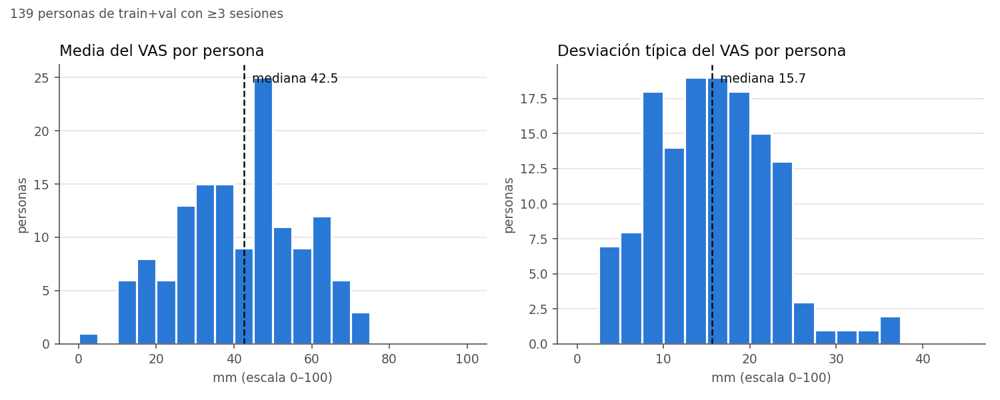
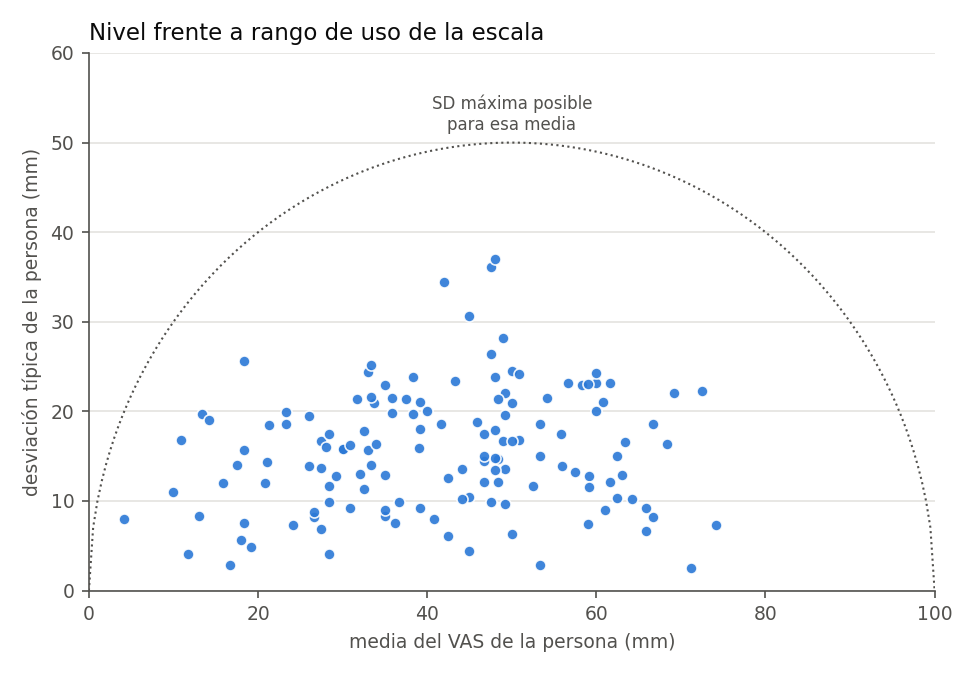
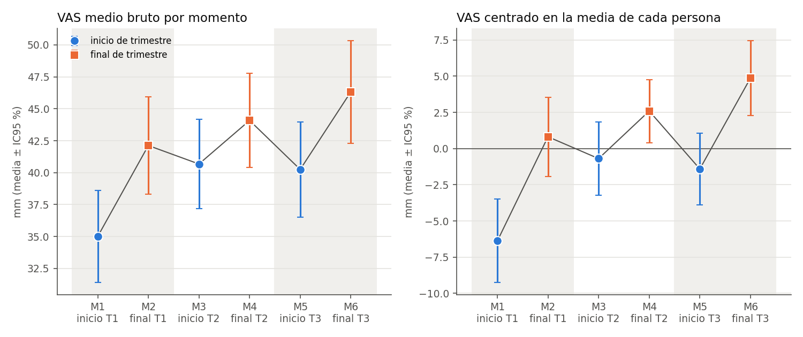

# Paso 1 — Caracterización descriptiva del VAS bruto

> Línea: normalización intra-sujeto del VAS (propuesta del tutor).
> Fecha: 2026-10-21. Exploratorio, **solo VAS**: no se lee EEG ni se entrena
> ningún modelo.

## Qué se pregunta

Antes de normalizar el VAS dentro de cada persona hay que saber qué se va a
normalizar:

1. Cuántas sesiones con VAS tiene cada persona y cuántas hay por momento.
2. Cuántas personas tienen ≥3 sesiones y cuántas tienen desviación típica = 0
   (a las que no se les podría tipificar).
3. Qué parte de la varianza del VAS bruto es entre personas (ICC).
4. Si los alumnos difieren solo en **nivel** (media) o también en **rango de
   uso de la escala** (desviación). Si solo fuese nivel, centrar bastaría; si
   también es rango, tipificar (z intra-persona) cambia algo más.
5. Cómo se mueve el VAS medio a lo largo de M1–M6, distinguiendo inicio y
   final de trimestre.

## Datos

- **Fuente:** `VAS_100mm_preFE_filtrado.csv` completo (M1–M6), normalizado con
  `normalizar_vas` de la Fase 12 (misma `persona_uid`, misma corrección
  F111/F115, misma eliminación del duplicado exacto). M1 no tiene EEG pero sí
  VAS, así que aquí entra.
- **Partición:** el split de cada persona se toma de `labels.csv` (heredado de
  `splits.csv` con las correcciones de la Fase 12). **Test apartado en el
  primer paso:** 150 respuestas de 28 personas. Las 7 personas que solo están
  en el VAS (sin EEG y, por tanto, sin split; 8 respuestas) también quedan
  fuera: no se sabe a qué lado de la partición caerían.
- **Analizado:** **786 sesiones de 146 personas** (121 train + 25 val).
  Agrupado siempre por `persona_uid`; se comprueba que ningún participante
  real (`CÓDIGO`) aparece con dos `persona_uid` dentro del análisis.
- "Sesión" aquí = una respuesta del VAS (persona × momento), tenga o no EEG.
  Como referencia se repite el ICC sobre las **547 sesiones etiquetadas con
  EEG** de train+val (las de las Fases 14 y siguientes).

## Resultados

### Tabla resumen

| | Valor |
|---|---|
| Personas / sesiones (train+val, M1–M6) | 146 / 786 |
| Sesiones por persona | mediana 6, media 5.38 |
| Personas con 6 / 5 / 4 / 3 / 2 / 1 sesiones | 98 / 27 / 9 / 5 / 5 / 2 |
| Sesiones por momento M1…M6 | 132 · 132 · 126 · 131 · 129 · 136 |
| **Personas con ≥3 sesiones** | **139** de 146 |
| **Personas con SD = 0** | **0** de las 139 con ≥3 (1 de las 144 con ≥2) |
| Personas con SD < 5 mm | 7 de 139 |
| **ICC(1), VAS M1–M6** | **0.403** · IC95 F [0.328, 0.484] · bootstrap por persona [0.321, 0.479] |
| ICC(1), VAS M2–M6 | 0.458 · IC95 F [0.377, 0.541] · bootstrap [0.372, 0.532] |
| ICC(1), sesiones con EEG (547) | 0.470 · IC95 F [0.384, 0.557] · bootstrap [0.374, 0.554] |
| σ² entre / dentro de persona (M1–M6) | 193.0 / 285.9 |
| Media por persona (≥3 sesiones): P10 · mediana · P90 | 19.0 · 42.5 · 61.8 (rango 4.2–74.2) |
| SD por persona (≥3 sesiones): P10 · mediana · P90 | 7.4 · 15.7 · 23.5 (rango 2.5–37.0) |
| Heterogeneidad de las SD frente a la nula de dispersión común | razón 1.18, p = 0.0004 |
| Spearman SD ~ distancia de la media al borde de la escala | ρ = +0.27 (p = 0.001) |
| Final − inicio de trimestre, dentro de persona | +5.6 mm (IC95 ±2.6) |
| Ídem, controlando deriva lineal por visita, M2–M6 | +3.8 mm, IC95 [+1.2, +6.4] |
| R² de la media por momento sobre el VAS bruto | 0.027 |

Tablas completas en `tablas/`, salida íntegra en `ejecucion.log` y cifras en
`resultados.json`.

### 1–2. Sesiones por persona

La cobertura es muy buena: dos tercios de las personas tienen las 6
respuestas y **139 de 146 (95 %) tienen ≥3**. Ninguna de ellas responde
siempre lo mismo (SD = 0 solo aparece en una persona con 2 sesiones), así que
**la tipificación intra-persona es calculable para todas las que tienen ≥3
sesiones**; 7 tienen una SD < 5 mm, y en ellas una z amplificaría mucho
diferencias de 5–10 mm.

Si la normalización se restringe al rango con EEG (M2–M6), 135 de 146 siguen
teniendo ≥3 sesiones (102 con las 5).

### 3. ICC

**El 40 % de la varianza del VAS bruto es entre personas** (ICC = 0.40,
IC95 ≈ [0.32, 0.48], coinciden el analítico y el bootstrap); el 60 % es de
sesión a sesión. Sin M1 sube a 0.46, y sobre las sesiones con EEG a 0.47,
en línea con el 0.457 de la Fase 12 (calculado con test incluido). M1 baja el
ICC porque añade varianza intra-persona: es el momento más bajo de todos
(ver punto 5), un desplazamiento común que cuenta como variación "dentro".

Consecuencia directa para la línea: centrar por persona elimina del orden del
40–47 % de la varianza de la etiqueta. Lo que queda es exactamente la parte
que un modelo de "persona conocida" (Tarea B de la Fase 14) tiene que
explicar.

### 4. Nivel frente a rango





- **Nivel:** las medias por persona se reparten casi por toda la escala útil
  (P10–P90: 19–62 mm). Es la diferencia dominante.
- **Rango:** las SD van de 7 a 24 mm entre P10 y P90 (×3.2). Pero buena
  parte de esa dispersión es **ruido de estimación**: una SD calculada con
  5–6 respuestas es muy inestable. Si todos los alumnos tuvieran la misma
  dispersión, el azar ya produciría una SD de las SD de 5.7 mm; la observada
  es 6.75. **La diferencia en rango existe (p = 0.0004), pero es modesta**:
  ~1.18 veces lo esperable por puro muestreo.
- Parte de esa diferencia es **efecto techo/suelo**, no estilo de respuesta:
  quien puntúa cerca de un extremo tiene menos sitio para moverse (ρ = +0.27
  entre la SD y la distancia de la media al borde). Visualmente, la nube no
  se acerca al límite teórico: nadie usa la escala a lo bruto.
- La SD no crece con el nivel (ρ media–SD = +0.15, p = 0.09).

**Lectura:** los alumnos difieren sobre todo en nivel y, en menor medida,
también en rango. Para el paso siguiente eso significa que el **centrado** es
la transformación robusta; la **tipificación** divide por una SD que con 5–6
puntos está estimada con mucho ruido (y en 7 personas es < 5 mm), así que
conviene compararla con una versión que encoja la SD de cada persona hacia la
SD común antes de dividir.

### 5. VAS medio por momento



| | M1 | M2 | M3 | M4 | M5 | M6 |
|---|---|---|---|---|---|---|
| | inicio T1 | final T1 | inicio T2 | final T2 | inicio T3 | final T3 |
| n | 132 | 132 | 126 | 131 | 129 | 136 |
| Media bruta (mm) | 35.0 | 42.1 | 40.7 | 44.1 | 40.2 | 46.3 |
| IC95 | [31.4, 38.6] | [38.3, 45.9] | [37.2, 44.2] | [40.4, 47.8] | [36.5, 44.0] | [42.3, 50.4] |
| Centrada en la persona | −6.4 | +0.8 | −0.7 | +2.6 | −1.4 | +4.9 |

Patrón en dientes de sierra: **en los tres trimestres el final está por
encima del inicio siguiente**, y M1 (inicio de curso) es el valor más bajo.
Dentro de persona, final − inicio = +5.6 mm. No lo explica solo una deriva a
lo largo del curso: con un término lineal por visita en el mismo modelo, el
efecto de final de trimestre se mantiene (+4.5 mm con M1, +3.8 mm
[+1.2, +6.4] sin M1); la deriva queda en +0.7 mm por visita sin M1 (IC
incluye 0).

Matiz importante frente a la Fase 12, que dice que el momento "no mueve el
VAS de forma apreciable": sigue siendo cierto en **varianza** (el momento
explica el 2.7 % del VAS bruto), pero el efecto es **sistemático** y con la
dirección esperable para fatiga acumulada en el trimestre. Al centrar por
persona la varianza entre personas desaparece y este efecto pasa a ser una
fracción mayor de lo que queda.

## Conclusión

1. **Hay datos para normalizar intra-sujeto:** 139 de 146 personas con ≥3
   sesiones, ninguna con SD = 0.
2. **El VAS bruto es 40 % persona y 60 % sesión** (ICC 0.40 [0.32, 0.48];
   0.46–0.47 en el rango con EEG).
3. **Los alumnos difieren sobre todo en nivel**; en rango también, pero
   modestamente y en parte por el techo/suelo de la escala. Centrar es seguro;
   tipificar con la SD bruta de 5–6 puntos introduce ruido.
4. **El calendario sí deja huella dentro de persona**: final de trimestre
   ≈ +4–6 mm sobre inicio, con M1 claramente más bajo. Pequeño en varianza,
   pero consistente; tras normalizar será parte de la señal intra-persona.

## Para el paso siguiente

- Comparar tres versiones de la etiqueta: centrada, z intra-persona y z con
  la SD encogida hacia la común. Decidir el mínimo de sesiones (≥3 parece
  razonable: solo excluye 7 personas).
- Decidir si M1 entra en la media/SD de referencia de cada persona. Aporta una
  sesión más de VAS (sin EEG) pero desplaza la media hacia abajo, por ser el
  momento más bajo.
- Decidir qué hacer con el efecto de calendario (dejarlo en la etiqueta o
  quitarlo), sabiendo que es la estructura más clara del VAS intra-persona.
- Cualquier estadístico de normalización se estima **solo en train** (o
  dentro de cada pliegue); el test sigue cerrado.

## Reproducir

```bash
python analisis/normalizacion_vas/01_descriptivo/descriptivo_vas.py > analisis/normalizacion_vas/01_descriptivo/ejecucion.log
```

Semilla 42 (bootstrap de 5000 réplicas y 5000 permutaciones).

## Archivos

| Archivo | Contenido |
|---|---|
| `descriptivo_vas.py` | Script reproducible |
| `ejecucion.log` | Salida completa de la ejecución |
| `resultados.json` | Todas las cifras |
| `tablas/sesiones_por_persona.csv` | Distribución de sesiones por persona (M1–M6 y M2–M6) |
| `tablas/icc.csv` | ICC(1), componentes de varianza e IC de los tres conjuntos |
| `tablas/media_sd_por_persona_resumen.csv` | Resumen de media, SD y rango por persona |
| `tablas/vas_por_momento.csv` | Media bruta y centrada por momento, con IC95 |
| `figuras/hist_media_sd_por_persona.png` | Histogramas de media y SD por persona |
| `figuras/media_vs_sd_por_persona.png` | Media frente a SD por persona, con el límite de la escala |
| `figuras/vas_por_momento.png` | VAS medio por momento, bruto y centrado; inicio/final de trimestre |
