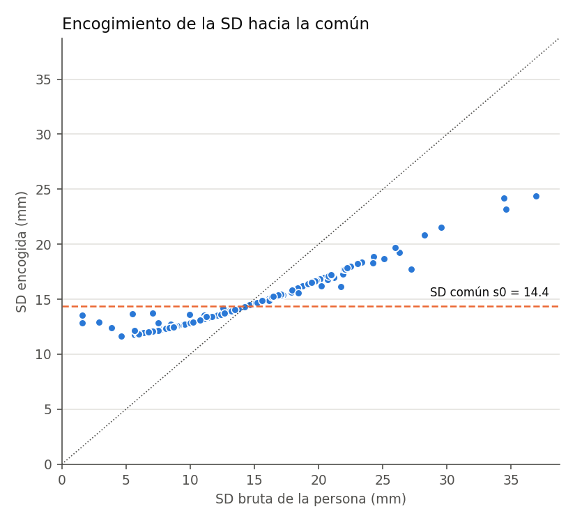
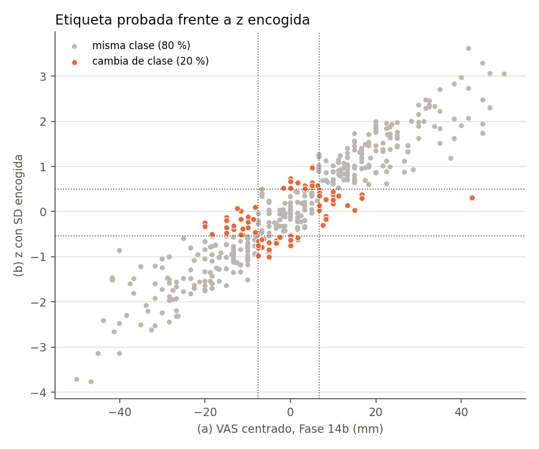
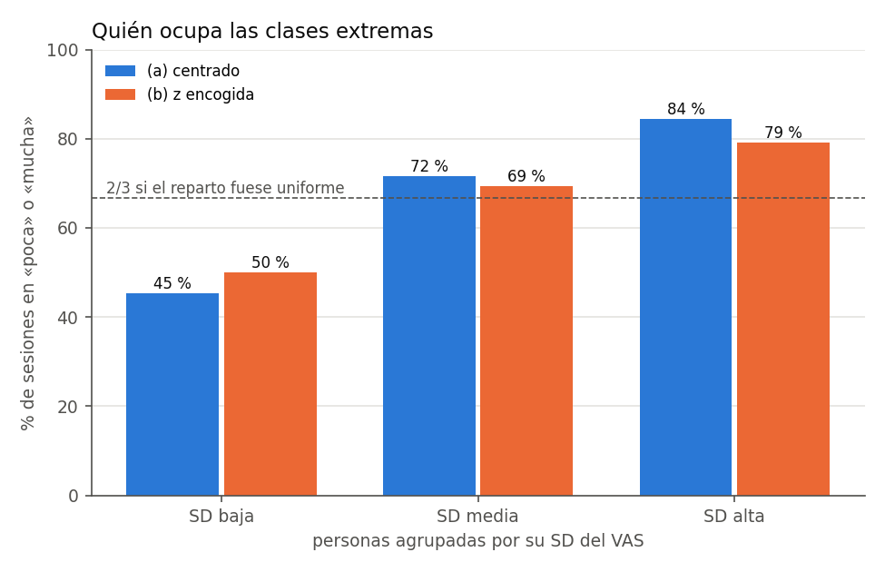

# Paso 2 — Etiquetas normalizadas: ¿cambian algo respecto a lo ya probado?

> Línea: normalización intra-sujeto del VAS. Fecha: 2026-10-21.
> **Solo VAS, sin EEG ni modelos.** Solo `train` + `val`.

## Plan y criterio de decisión (escrito antes de calcular)

Esta sección se redactó **antes** de ejecutar el script y no se ha modificado
después. Los resultados van en las secciones siguientes.

### Por qué este paso

La Tarea B de las Fases 14/14b ya usa una etiqueta normalizada por persona: el
VAS **centrado** en la media leave-one-out (LOO) de las otras sesiones con EEG
de la persona. Eso es la referencia (a). Con ella el EEG dio una exactitud
balanceada de 0.3947 (0.3795 con control de visita) que el test no confirmó.

Esta línea solo puede cambiar la respuesta sobre el EEG si alguna
normalización produce una etiqueta **distinta** de (a). Este paso mide cuánto
cambian, sin entrenar nada.

### Sesiones objetivo

Son las sesiones etiquetadas con EEG de train+val (547), las mismas de las
Fases 14 y siguientes. La comparación con (a) se hace sobre las que tienen
etiqueta (a), es decir, las 537 de personas con ≥2 sesiones con EEG.

### Decisión previa 1: con qué respuestas se estima la referencia de la persona

Para cada sesión objetivo, la referencia (media y SD) se estima siempre **sin
esa sesión** (LOO), con uno de estos conjuntos de respuestas de la persona:

| | Conjunto de referencia |
|---|---|
| R1 | Otras sesiones **con EEG** (lo de la Fase 14) |
| R2 | Todas las otras respuestas del VAS en M2–M6, tengan o no EEG |
| R3 | R2 + M1 tal cual |
| R4 | R2 + M1 corregido por su desplazamiento medio respecto a M2–M6 |

**Criterio:** gana la referencia que mejor predice el VAS de la sesión que se
deja fuera, medido por el error cuadrático medio sobre las sesiones comunes.
Una referencia con menos error añade menos ruido a la desviación. Se elige la
de menor error **solo si** su mejora frente a R1 tiene un IC95 (bootstrap por
persona) que excluye 0; si no, se queda R1, que es lo ya probado.

### Variantes de la etiqueta

Todas usan la referencia elegida (R*).

- **(a)** Centrado con R1: la etiqueta de la Fase 14b. Es la referencia de
  comparación.
- **(a′)** Centrado con R*. Coincide con (a) si R* = R1.
- **(b)** z con la SD **encogida**: (VAS − media R*) / SD encogida. La SD LOO
  de cada persona (con 3–5 puntos) se encoge hacia una SD común con el
  estimador empírico-bayesiano de varianzas de Smyth (limma): los grados de
  libertad de la previa y la SD común se estiman de los datos, sin ningún
  parámetro elegido a mano.
- **(c)** (a′) menos el efecto medio de cada momento (M2–M6). Quita el patrón
  de inicio/final de trimestre del paso 1, no solo una recta.

Solo informativas, fuera del criterio: z con la SD bruta (sin encoger), para
ver por qué hace falta encoger; y (a) residualizada por visita, que es la
etiqueta confirmatoria del pre-registro.

### Criterio de decisión

Para cada variante se calculan sus tercios (cortes en los percentiles 33.3 y
66.7 de la propia variante) y se compara la clase con la de (a) en las mismas
sesiones.

- **Si (a′), (b) y (c) coinciden con (a) en ≥ 90 % de las sesiones**, la
  normalización no puede cambiar de forma apreciable la respuesta sobre el
  EEG. **La línea se cierra** como resultado negativo informativo, sin volver
  al EEG.
- **Si alguna coincide en < 90 %**, el paso 3 prueba en el EEG **una sola
  variante principal**, fijada así: (b) si no llega al 90 %; si no, la primera
  que no llegue en el orden (c), (a′). El resto se reportan como secundarias.
  El paso 3 usa el banco de la Tarea B (GroupKFold por persona, X e y
  normalizados igual, cortes por pliegue, bootstrap por persona, control de
  visita).

Como métricas secundarias, solo descriptivas, se dan el kappa ponderado
lineal y la ρ de Spearman entre variantes continuas.

### Limitaciones asumidas

Los dos hiperparámetros del encogimiento, el desplazamiento de M1, el efecto
de cada momento y los cortes de los tercios se estiman aquí sobre todo
train+val, porque no hay modelo que evaluar. En el paso 3 se estimarían dentro
de cada pliegue de entrenamiento.

---

## Resultados

### Datos

786 respuestas del VAS de 146 personas de train+val, de las cuales 547 son
sesiones con EEG etiquetado. El VAS de `labels.csv` coincide con el del CSV
en todas ellas. La variante (a) reproduce la etiqueta de la Fase 14b: 537
sesiones, SD 18.2 mm, rango ±50, idéntica valor a valor a
`centrar_por_persona_loo`.

### Decisión 1: la referencia gana con todas las respuestas del VAS y M1 corregido

Error al predecir el VAS de la sesión dejada fuera, sobre las 537 sesiones
comunes:

| Ref. | Conjunto | Sesiones con referencia | Respuestas por referencia (mediana) | MSE | MAE | ΔMSE vs R1 [IC95] |
|---|---|---|---|---|---|---|
| R1 | otras con EEG (Fase 14) | 537 | 3 | 332.3 | 14.25 | — |
| R2 | todas M2–M6 | 542 | 4 | 320.7 | 14.04 | −11.6 [−20.7, −3.1] |
| R3 | R2 + M1 tal cual | 545 | 5 | 315.0 | 14.05 | −17.4 [−31.8, −3.6] |
| **R4** | **R2 + M1 corregido** | **545** | **5** | **311.9** | **14.03** | **−20.5 [−35.2, −5.9]** |

M1 queda de media **7.8 mm por debajo** de la media M2–M6 de la misma persona
(132 personas). Corregido ese desplazamiento, M1 aporta información útil
sobre el nivel habitual. **Se elige R4.** Reduce el error de la referencia un
6 % y da referencia propia a 8 sesiones más (545 frente a 537).

### Encogimiento de la SD



La previa estimada tiene d0 = 7.9 grados de libertad y una SD común de
14.4 mm. Es un encogimiento **fuerte**: una persona con 5 respuestas (4 gl)
solo pone un 34 % de peso en su propia SD. El rango P10–P90 de las SD pasa de
7.1–22.5 mm (bruta) a 12.3–17.9 mm (encogida). Cuadra con el paso 1: la mayor
parte de la dispersión de las SD era ruido de estimación.

### Criterio: acuerdo de tercios con (a)

| Variante | Acuerdo con (a) | κ lineal | ρ | Cambios de dos niveles |
|---|---|---|---|---|
| (a′) centrado con R4 | **80.8 %** | 0.785 | 0.934 | 0 |
| (b) z con SD encogida | **80.3 %** | 0.779 | 0.931 | 0 |
| (c) (a′) sin efecto de momento | **78.0 %** | 0.749 | 0.909 | 2 |
| *z con SD bruta (informativa)* | 77.7 % | 0.750 | 0.902 | 0 |
| *(a) residualizada por visita (informativa)* | 67.6 % | 0.579 | 0.746 | 28 |

**Ninguna llega al 90 %.** Aplicando el criterio fijado de antemano, **hay
paso 3, con (b) como variante principal**, y (a′) y (c) como secundarias.

### Lo que hay detrás: cambia la referencia, no la tipificación

Esta descomposición **no estaba en el plan**: se añadió al ver que (a′), que
solo cambia la referencia, ya se separa de (a) tanto como (b). No altera la
decisión, pero cambia cómo hay que leerla.

| Comparación | Acuerdo | κ lineal | ρ |
|---|---|---|---|
| (b) frente a (a′): solo la tipificación | **96.7 %** | 0.963 | 0.996 |
| (c) frente a (a′): solo el efecto de momento | 88.1 % | 0.866 | 0.979 |
| (c) frente a (a) residualizada por visita | 59.0 % | 0.471 | 0.669 |



1. **La tipificación apenas cambia nada:** con la SD encogida, (b) y (a′)
   coinciden en el 96.7 % de los tercios. Casi todo el 20 % de sesiones que
   cambian de clase entre (a) y (b) se debe a **estimar mejor la
   referencia**, no a dividir por la SD.
2. El mecanismo esperado de la tipificación existe, pero es pequeño. Las
   personas de SD baja pasan de tener el 45 % de sus sesiones en las clases
   extremas al 50 %, y las de SD alta bajan del 84 % al 79 %:

   

3. **Los tercios son frágiles.** Dos etiquetas con ρ = 0.93 discrepan en una
   de cada cinco sesiones, todas al escalón de al lado y casi todas cerca
   de los cortes (figura de dispersión). La etiqueta de la Fase 14b lleva por tanto
   un componente de ruido apreciable que viene solo de con qué respuestas se
   estimó el nivel habitual.
4. **El control de visita del pre-registro es una transformación mucho más
   agresiva que quitar el efecto de momento.** Ajusta una recta *por persona*
   con 3–5 puntos y coincide con (a) solo en el 67.6 %, con 28 saltos de dos
   niveles. Quitar el efecto medio de cada momento, común a todos, cambia
   mucho menos (88.1 % frente a (a′)).

## Conclusión

1. **Hay paso 3**, según el criterio fijado: ninguna variante coincide con la
   etiqueta ya probada en ≥ 90 % de los tercios. La variante principal es
   **(b), z con SD encogida y referencia R4**.
2. **Lo que se va a probar en realidad es una referencia mejor, no una
   escala nueva.** Tipificar con la SD encogida apenas mueve la etiqueta
   (96.7 % de acuerdo con el centrado sobre la misma referencia). El cambio
   que importa es estimar el nivel habitual con **todas** las respuestas del
   VAS de la persona, incluida M1 corregida en −7.8 mm, y no solo con las que
   tienen EEG. Eso reduce un 6 % el error de la referencia
   (IC95 de la mejora: 1.8 %–10.6 %) y recupera 8 sesiones.
3. **Expectativa honesta para el paso 3:** la etiqueta cambia en una de cada
   cinco sesiones, pero la mejora de la referencia es modesta. Si el EEG
   apenas se mueve respecto al 0.3947 / 0.3795 de la Fase 14b, eso refuerza la
   conclusión actual. Si se mueve mucho en cualquier dirección, el resultado
   dice sobre todo que la cifra de la Fase 14b dependía de cómo se construyó
   la etiqueta. Ambas lecturas son útiles para el objetivo.

## Para el paso 3

- Mismo banco que la Tarea B de la Fase 14b, mismo RF (500 árboles,
  hoja ≥ 5), GroupKFold(5) por persona. Se reporta en la misma ejecución la
  réplica con (a), que debe dar 0.3947, para que la comparación sea directa.
- **Dentro de cada pliegue** se estiman, solo con las personas de
  entrenamiento: el desplazamiento de M1, la previa (d0, s0), el efecto de
  momento de (c) y los cortes de los tercios. La referencia de cada persona
  usa solo sus propias otras respuestas, así que no cruza pliegues.
- X se sigue centrando por la media LOO de las otras sesiones con EEG de la
  persona, que es la única X que existe. Queda por fijar si en (c) el efecto
  de momento se quita también de X; recomendación: sí, por simetría con el
  control de visita.
- Principal (b); secundarias (a′) y (c); también con control de visita. Se
  reportan todas.

## Reproducir

```bash
python analisis/normalizacion_vas/02_etiquetas/etiquetas_normalizadas.py > analisis/normalizacion_vas/02_etiquetas/ejecucion.log
```

Semilla 42 (bootstrap de 5000 réplicas por persona).

## Archivos

| Archivo | Contenido |
|---|---|
| `etiquetas_normalizadas.py` | Script reproducible |
| `ejecucion.log` | Salida completa |
| `resultados.json` | Todas las cifras y la decisión |
| `tablas/referencias.csv` | Error de cada conjunto de referencia R1–R4 |
| `tablas/acuerdo_con_a.csv` | Acuerdo, κ y ρ de cada variante (incluida la descomposición) |
| `tablas/clases_extremas_por_sd.csv` | % de sesiones en clases extremas por grupo de SD, (a) frente a (b) |
| `figuras/sd_bruta_vs_encogida.png` | Encogimiento de la SD de cada persona |
| `figuras/centrada_vs_z_encogida.png` | (a) frente a (b), sesiones que cambian de tercio |
| `figuras/clases_extremas_por_sd.png` | Quién ocupa las clases extremas con cada etiqueta |
