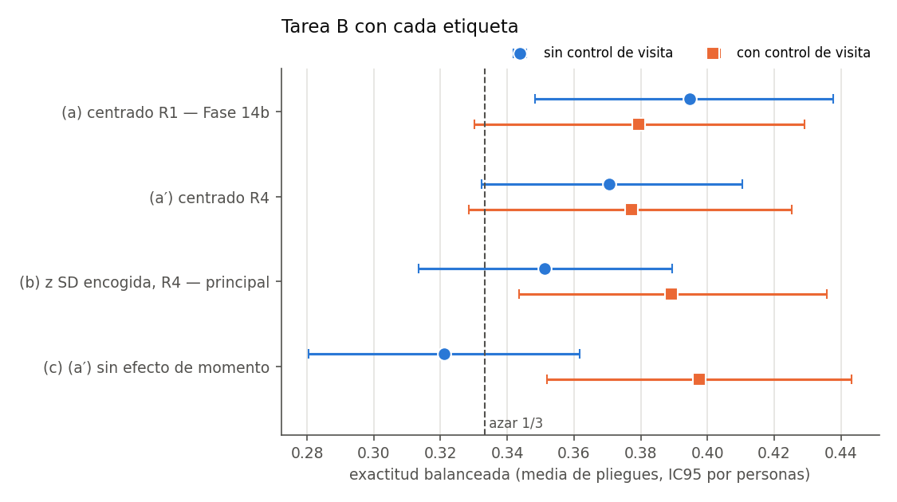
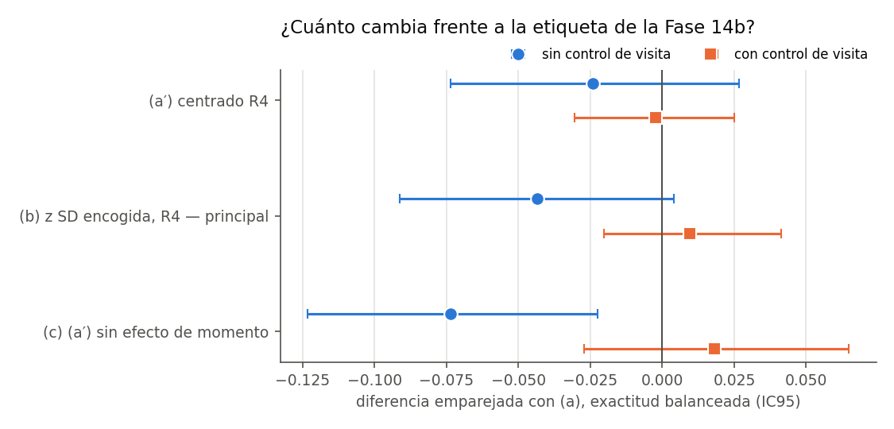

# Paso 3 — ¿Cambia la respuesta del EEG con la etiqueta normalizada?

> Línea: normalización intra-sujeto del VAS. Fecha: 2026-10-21.
> **Solo `train` + `val`.** El test está gastado: todo lo de este paso es
> **exploratorio** y así debe citarse.

## Plan y reglas de lectura (escrito antes de ejecutar)

Esta sección se redactó **antes** de ejecutar el script y no se ha modificado
después.

### Pregunta

El paso 2 encontró que la etiqueta normalizada (b) difiere de la de la Fase
14b en uno de cada cinco tercios, sobre todo por estimar mejor el nivel
habitual de la persona. ¿Cambia eso lo que el EEG consigue en la Tarea B
(persona conocida)?

### Banco: el de la Fase 14b sin cambios, salvo la etiqueta

- Matriz `matriz_rf.parquet`. El test se aparta **antes** de agregar a
  sesión, como en `analisis_control_visita.py`.
- **Las mismas 537 sesiones / 136 personas de la Fase 14b** para todas las
  variantes. Las 8 sesiones que (b) recupera no entran: son de personas con
  una sola sesión con EEG, así que su X no se puede centrar.
- X centrada por la media LOO de las otras sesiones con EEG de la persona.
- RF 500 árboles, hoja ≥ 5, semilla 42. GroupKFold(5) por `persona_uid` (los
  mismos pliegues que la Fase 14b). Tercios cortados en cada pliegue de
  entrenamiento.
- Exactitud balanceada por pliegue y promediada. IC95 por bootstrap de 2000
  réplicas remuestreando personas (`bootstrap_metrica` de la Fase 14b).

### Variantes (definidas en el paso 2)

| | Etiqueta | X | Parámetros que se estiman **en el pliegue de entrenamiento** |
|---|---|---|---|
| (a) | centrado R1 (Fase 14b) | centrada | cortes |
| (a′) | centrado R4 | centrada | desplazamiento de M1, cortes |
| **(b)** | **z con SD encogida, R4** | centrada | desplazamiento de M1, previa (d0, s0), cortes |
| (c) | (a′) sin efecto de momento | centrada y sin efecto de momento | desplazamiento de M1, efecto de momento en y y en X, cortes |

La referencia de cada persona solo usa sus propias respuestas, así que no
cruza pliegues. Cada variante se corre también **con control de visita**
(recta por persona en X e y, `residualizar_por_visita`, como en el
pre-registro).

### Comprobación previa obligatoria

(a) tiene que reproducir **0.3947** sin control y **0.3795** con control.
Si no, el script se detiene: la comparación no valdría nada.

### Estadístico principal

- **(b) sin control frente a (a) sin control**: diferencia de exactitud
  balanceada **emparejada**. Mismas sesiones, mismos pliegues y mismo modelo;
  solo cambia la etiqueta. IC95 por bootstrap de personas, remuestreando las
  mismas personas para las dos.
- Secundarios: lo mismo para (a′) y (c), y las cuatro variantes con control
  de visita.
- Estabilidad: (a) y (b) con 4 semillas más del RF (1–4), para tener la
  escala de la variación debida solo al modelo.

### Reglas de lectura

1. **IC95 de (b) − (a) que contiene 0:** normalizar la etiqueta no cambia la
   respuesta del EEG. La conclusión de las Fases 14/14b se mantiene, y la
   línea se cierra con ese resultado.
2. **IC95 por encima de 0:** la etiqueta mejor estimada deja ver más señal.
   Es un resultado exploratorio, que sirve como hipótesis para datos futuros,
   no como confirmación.
3. **IC95 por debajo de 0:** la cifra de la Fase 14b dependía de cómo se
   construyó la etiqueta, y eso debilita su lectura.

Con cualquiera de las tres, se reporta también si el IC de (b) contra el azar
(1/3) lo excluye. Se reportan **todas** las variantes, no la mejor.

---

## Resultados

### Datos y comprobación previa

- 547 sesiones de train+val; el test (732 grabaciones) se aparta antes de
  agregar. Tarea B: **537 sesiones de 136 personas**, 77 features.
- **(a) reproduce exactamente las cifras documentadas:** 0.3947 sin control
  y 0.3795 con control, con los mismos valores por pliegue. La comparación es
  válida.

### Exactitud balanceada de cada variante



| Variante | Sin control de visita | Con control de visita |
|---|---|---|
| (a) centrado R1 — Fase 14b | **0.3947** [0.3484, 0.4376] | 0.3795 [0.3302, 0.4290] |
| (a′) centrado R4 | 0.3705 [0.3323, 0.4105] | 0.3773 [0.3284, 0.4252] |
| **(b) z SD encogida, R4 — principal** | **0.3512** [0.3134, 0.3895] | 0.3891 [0.3435, 0.4357] |
| (c) (a′) sin efecto de momento | 0.3211 [0.2804, 0.3616] | 0.3976 [0.3519, 0.4433] |

Azar = 0.3333. IC95 por bootstrap de personas (2000 réplicas).

### Estadístico principal: diferencia emparejada con (a)



| Variante | Δ sin control [IC95] | Δ con control [IC95] | Clases reales distintas de (a), sin / con control |
|---|---|---|---|
| (a′) | −0.024 [−0.074, +0.027] | −0.002 [−0.031, +0.025] | 19.6 % / 2.6 % |
| **(b)** | **−0.044 [−0.091, +0.004]** | +0.010 [−0.020, +0.041] | 20.1 % / 3.7 % |
| (c) | **−0.074 [−0.123, −0.023]** | +0.018 [−0.027, +0.065] | 23.3 % / 14.3 % |

Estabilidad frente a la semilla del RF (sin control, semillas 42 y 1–4):

| | Exactitud balanceada por semilla | Media (SD) |
|---|---|---|
| (a) | 0.3947 · 0.3877 · 0.3593 · 0.3894 · 0.3818 | 0.3826 (0.014) |
| (b) | 0.3512 · 0.3580 · 0.3676 · 0.3608 · 0.3505 | 0.3576 (0.007) |
| (b) − (a) | −0.044 · −0.030 · +0.008 · −0.029 · −0.031 | −0.025 |

### Lectura según las reglas fijadas

**Regla 1.** El IC95 de (b) − (a) contiene 0 (−0.044 [−0.091, +0.004]):
**normalizar la etiqueta no cambia la respuesta del EEG**, y la conclusión de
las Fases 14/14b se mantiene. El IC de (b) frente al azar,
[0.313, 0.390], **no lo excluye**.

La regla se cumple por poco, y el punto va en contra: la etiqueta mejor
construida no ayuda al EEG; si acaso, le quita. Cuatro de las cinco semillas
dan (b) por debajo de (a).

### Lo que añaden las variantes secundarias

1. **Sin control de visita, cada paso hacia una etiqueta "más limpia" baja el
   resultado:** 0.395 (a) → 0.371 (a′) → 0.351 (b) → 0.321 (c). Quitar el
   efecto de cada momento a X e y deja la Tarea B en el azar (τ = −0.011). Es
   la única diferencia de las seis cuyo IC excluye 0, sin corregir por
   comparaciones múltiples.
2. **Con control de visita las etiquetas casi no difieren**, así que las
   comparaciones no informan sobre la referencia ni sobre la tipificación.
   `residualizar_por_visita` vuelve a centrar a cada persona *en muestra*, lo
   que borra la diferencia entre las referencias R1 y R4: solo cambian de
   clase el 2.6–3.7 % de las sesiones. Todas las variantes con control quedan
   entre 0.377 y 0.398.
3. **El 0.3947 de la Fase 14b está en lo alto del rango de semillas**
   (0.359–0.395, media 0.383). No cambia ninguna conclusión anterior, pero la
   cifra representativa de (a) sin control está más cerca de 0.38.
4. **Un indicio que no se puede confirmar aquí.** La caída de (c) sin control
   sugiere que parte de lo que el bosque aprende en la Tarea B es la
   estructura del calendario (inicio/final de trimestre) compartida por el
   EEG y el VAS, y no la fatiga de una sesión frente a otras del mismo
   momento. Pero (c) **con** control recupera 0.398, así que es un indicio,
   no un resultado.

## Conclusión

1. **La normalización intra-sujeto del VAS no mejora lo que el EEG consigue
   decir sobre la fatiga percibida.** La variante principal (z con SD
   encogida y la referencia mejor estimada) da 0.351 [0.313, 0.390], sin
   excluir el azar, y −0.044 [−0.091, +0.004] frente a la etiqueta de la Fase
   14b.
2. **Lo que muestra la línea en conjunto es fragilidad.** Con decisiones
   razonables y defendibles sobre cómo construir la misma etiqueta, el
   resultado de la Tarea B va de 0.32 a 0.40. Ninguna variante lo vuelve
   robusto. Encaja con que el test no confirmara la prueba principal: lo que
   las features agregadas captan de la fatiga percibida es, como mucho, débil
   y depende de cómo se construye la etiqueta.
3. Para el objetivo del TFG, **«¿contiene el EEG información sobre la fatiga
   mental que percibe el alumno?»**, esta línea refuerza la respuesta actual.
   Con estas features espectrales agregadas no hay evidencia robusta, ni para
   una persona nueva ni para una conocida, y normalizar la etiqueta no lo
   cambia.
4. **Según la regla 1 fijada de antemano, la línea se cierra aquí.**

## Lo que **no** hay que hacer

- Citar el 0.3976 de (c) con control como «la mejor variante». Es una de
  ocho, y elegirla a posteriori es exactamente el sesgo que el plan evita.
- Leer la caída de (c) sin control como prueba de un confusor de calendario.
  Es un indicio, sin corrección por comparaciones múltiples y contradicho por
  (c) con control.
- Seguir añadiendo variantes de la etiqueta sobre train+val. El test está
  gastado y cada variante más es otra mirada sin dato independiente que la
  contraste.

## Si se quisiera seguir (fuera de esta línea)

El indicio del punto 4 tiene una comprobación barata y directa: **¿predice el
EEG centrado por persona el momento (M2–M6), o el inicio/final de trimestre?**
Si lo hace bien, el calendario es un confusor plausible de todo análisis
intra-persona del VAS, y habría que contarlo en la memoria. No se ha
ejecutado. Sería un análisis nuevo con su propio plan escrito antes.

## Reproducir

```bash
python analisis/normalizacion_vas/03_eeg/eeg_etiqueta_normalizada.py > analisis/normalizacion_vas/03_eeg/ejecucion.log
python analisis/normalizacion_vas/03_eeg/eeg_etiqueta_normalizada.py --solo-figuras   # solo regenera las figuras
```

~9 min. Semilla 42 (RF y bootstrap); semillas 1–4 solo para la estabilidad.

## Archivos

| Archivo | Contenido |
|---|---|
| `eeg_etiqueta_normalizada.py` | Script reproducible; importa las etiquetas del paso 2 y el bootstrap de la Fase 14b |
| `ejecucion.log` | Salida completa |
| `resultados.json` | Todas las cifras, cortes y parámetros por pliegue |
| `tablas/exactitud_por_variante.csv` | Exactitud balanceada, IC, F1 y τ de las 8 combinaciones |
| `tablas/diferencias_con_a.csv` | Diferencias emparejadas con (a) y sus IC |
| `figuras/exactitud_por_variante.png` | Exactitud de cada variante, con y sin control |
| `figuras/diferencia_con_a.png` | Diferencia emparejada con la etiqueta de la Fase 14b |
